# v1.1 doğrulaması (AI denetimi AI-2 / AI-3, 2026-10-12; son koşu AI-8 ile 2026-10-13)

> **Ne değişti (docs/02 §10.1):** keeper tavanları havuzun anlık ETH'sinden değil kovadan hesaplanır ve simülasyon bunu birebir modeller (`params.json` `model.keeper`):
> - buyback günde kovanın en çok **1/20**'si, POL günde kovanın en çok **1/7**'si (v1.0 modeli POL kovasının tamamını her gün ekliyordu);
> - günde en çok **8 parça**, her biri fiyatı en çok ≈ %2 oynatır (zincirdeki çapa %3'e izin verir; LP eklemesi iki parça);
> - AI-7: token günlük mint tavanı 500K (önce 2M), parametre timelock'u 96 saat (önce 72 saat);
> - AI-8 (son koşu): havuzun %0,3 LP ücreti artık havuzda birikiyor ve keeper her gün topluyor (ETH tarafı buyback kovasına, MOHN tarafı yakıma); zap (tek taraflı POL ekleme) formülü ücreti iki kez, (1−f)² ile sayıyor. Aşağıdaki tablo bu son koşunun sonuçlarıdır.
>
> **Koşular:** v0.2 çalışmasıyla aynı tasarım (7 senaryo × 200 tohum, §12 kuralı kapalı 7 × 100, tank sınırı kapalı, duyarlılık, talep ×0,5 / ×2, tanılar); toplam 2.850 koşu. Sonuçlar `results/v11/`, grafikler `charts/v11/`. Tablolardaki "v0.2" başlıkları raporlayıcının sabit etiketidir; sütun v1.1 parametreleridir. Arz invaryantı her koşunun her gününde tuttu (en büyük sapma 8,6e-7). Birim testleri geçiyor; altın vektörler değişmedi.
>
> **Buyback oranı nasıl seçildi:** ilk deneme buyback'i de günde 1/7 ile yaptı. Genesis buyback kovası Market Open'dan sonra birkaç günde harcandı, 1. ay ortalama fiyatı ≈ 4 kat yükseldi (0,07 → 0,30 $) ve derin ayıda Gini 0,82 çıktı (kriter < 0,8). Aynı 100 tohumla nedeni ayrıştırıldı: 500K tavan ve 96 saat etkisiz, v1.0 modeli 0,76–0,77; kural kapalıyken 0,76. Buyback hızını düşürmek kriteri geri getirdi (1/30: 0,78; 1/20 + 8 parça: 0,78; 1/20 + 24 parça: 0,81). Kurucu **1/20 + günde 8 parça**yı seçti (kontratın Timelock alt sınırı %5 = 1/20). Bedeli: buyback kovasında ≈ 20 günlük gelir bekler.

## v1.1 §13 kabul kriterleri

| Kriter | Hedef | v0.2 | **v1.1** | v1.1, §12 kuralı kapalı |
|---|---|---|---|---|
| P(24. ay ort. > %30 × 2. ay ort.), baz | ≥ 0,5 | GEÇTİ (1,00) | **GEÇTİ (1,00)** | GEÇTİ (1,00) |
| Haftalık kohort giriş geri dönüşü < 365 gün, baz | ≥ %70 kohort | GEÇTİ (0,95) | **GEÇTİ (1,00; medyan 51 gün)** | GEÇTİ (1,00) |
| SR 12. ay, baz | ≥ 0,6 | GEÇTİ (0,72) | **GEÇTİ (0,71)** | GEÇTİ (0,71) |
| SR 12. ay, ayı / derin ayı | ≥ 0,3 | GEÇTİ (0,65 / 0,81) | **GEÇTİ (0,82 / 0,81)** | GEÇTİ (0,82 / 0,80) |
| Gini < 0,8, 7 senaryo | < 0,8 | 7/7 (en yüksek 0,775) | **7/7 (en yüksek 0,788, derin ayı)** | 7/7 (en yüksek churn 0,795) |
| Sybil oranı | ≤ 1,03 | GEÇTİ (1,026) | **GEÇTİ (1,03)** | GEÇTİ (1,03) |
| Ops runway (en kötü %5 hariç), 7 senaryo | > 12 ay | GEÇTİ (∞) | **GEÇTİ (∞)** | GEÇTİ (∞) |
| Günlük mint tavanı (500K) hiç bağlamaz | 0 gün | GEÇTİ | **GEÇTİ (0 gün)** | GEÇTİ |
| RCR 12. ay (sağlık metriği) | izlenir | 0,14 | 0,18 | 0,18 |

**Öne çıkanlar (baz, medyan):** 1. ay ortalama fiyat 0,053 $ (v0.2: 0,072), 2. ay 0,19 $, 12. ay 1,9 $, 24. ay 1,0 $; POL'ün ETH tarafı 12. ayda 1,26 M$ (v0.2: 1,07 M$; POL artık her gün kovanın 1/7'siyle eklendiği için daha düzenli büyüyor). Mutlak seviyeler talep kalibrasyonuna bağlıdır; dışarıya fiyat beklentisi olarak sunulmaz.

**İzlenecek zayıf nokta:** derin ayıda Gini 0,788 (P95 0,88), sınıra yakın. §12 kuralı derin ayıda yoğunlaşmayı artırıyor (kural kapalı 0,737). AI-8'den önceki koşuda §12 kuralı kapalıyken churn 0,806 ile kriteri geçemiyordu; LP ücretlerinin buyback'e dönmesiyle 0,795'e indi. Canlıda Gini/Nakamoto izlenir; kuralın derin ayı davranışı ayrı bir iş olarak gözden geçirilebilir.

---

# v0.2 doğrulaması (yol haritası adım 0.5)

> **Kapsam:** `docs/02` **v0.2** parametreleri ve yeni mekanikleri simülasyonda doğrulandı. docs/02 değiştirilmedi; bu bölüm yalnızca **öneri** yapar (§V.6).
>
> **Neler modellendi:**
> - `r = 2.000`;
> - ETH dağılımı 55/30/15;
> - §12 müdahale kuralı (r ±%25, gecikmeli, 30 günde en fazla bir değişiklik, fiyat sürekli yeniden çapalama);
> - genesis tank üst sınırı (Market Open + 24 saat);
> - genesis buyback kovası;
> - token düzeyinde `DAILY_MINT_CAP = 2.000.000` (sığmayan mint ertesi güne ertelenir);
> - saatlik mint ölçümü;
> - §13'ün v0.2 tanımları.
>
> **Koşular:**
> - v0.2: 7 senaryo × **200 tohum**
> - §12 kuralı kapalı varyant: 7 × 100
> - tank sınırı kapalı: baz × 200
> - duyarlılık: değer başına 50 tohum
> - talep ×0,5 / ×2: 50 tohum
> - 96 saatlik timelock kontrolü: 7 × 50
> - tanılar: 2 × 20
>
> Toplam 3.240 koşu, ≈ 37 dakika. v0.1 sütunu, v0.1 çalışmasının 200 tohumluk koşularının v0.2 tanımlarıyla yeniden değerlendirilmesidir. Güncel motor `param_sets/v01.json` ile bu koşuları ~1e-15 farkla birebir üretiyor.
>
> **Doğruluk:**
> - Arz invaryantı (E2) tüm koşularda her gün sağlandı; en büyük sapma 8,9e-7 DIG.
> - 42 birim testi geçiyor. Yeni testler: mint tavanı ertelemesi, genesis tank sınırı, r yeniden çapalama ve §12 kuralı.
> - Altın vektörler yeniden üretildi (`vectors/README.md`).
>
> **Adlandırma:** docs v0.2+ temayı değiştirdi; simülasyon iç adlarını koruyor. Eşleme:
>
> | Simülasyondaki ad | docs v0.2+ adı |
> |---|---|
> | enerji, kWh, kW, `π_kWh` | dizel yakıt, litre (ℓ), ℓ/h, `π_ℓ` |
> | üs (outpost), slot | sondaj sahası (Drill Site), ped |
> | Hand Auger / Rotary Drill / Percussion Rig / Thermal Lance | Pilot Rig / Rotary Rig / Top Drive / Turbodrill |
> | Diamond Core Drill, Plasma Bore | adları aynı |
> | Topsoil / Clay & Gravel / Bedrock / Crystal Caverns | Regolith / Sediment Cover / Granite Basement / Archean Gneiss |
> | Iron Seams / Mantle Rim / Magma Veins | Granulite Floor / Peridotite Zone / Asthenosphere |
>
> Token MOHO = simülasyonda DIG. Matematik aynıdır.
>
> **Timelock:** Ana çalışma 72 saatlik gecikmeyle koştu; docs/02 artık **96 saat** diyor. Aynı 50 tohumda 96 saatlik gecikme r yolunu değiştirmedi; SR, geri dönüş, oyuncu, Gini ve fiyat farkları ≤ 0,03 (§V.4).

## V.1 §13 kabul kriterleri: v0.1 ile v0.2 (v0.2 tanımlarıyla)

| Kriter (v0.2 tanımı) | Hedef | v0.1 parametreleri | **v0.2** | v0.2, §12 kuralı kapalı |
|---|---|---|---|---|
| P(24. ay ort. > %30 × **2. ay** ort.), baz | ≥ 0,5 | GEÇTİ (0,94) | **GEÇTİ (1,00)** | GEÇTİ (1,00) |
| Haftalık kohort giriş geri dönüşü < 365 gün, baz | ≥ %70 kohort | **KALDI (0,15)** | **GEÇTİ (0,95; medyan 96 gün)** | GEÇTİ (0,96) |
| SR 12. ay, baz | ≥ 0,6 | GEÇTİ (0,70) | **GEÇTİ (0,72)** | GEÇTİ (0,72) |
| SR 12. ay, ayı / derin ayı | ≥ 0,3 | GEÇTİ (0,56 / 0,50) | **GEÇTİ (0,65 / 0,81)** | GEÇTİ (0,64 / 0,80) |
| Gini < 0,8 (cüzdan, aktif DP, 3–36. ayların en yükseği), 7 senaryo | < 0,8 | **5/7** (ayı 0,87, churn 0,82) | **7/7** (en yüksek: derin ayı 0,775) | 7/7 (churn 0,798) |
| Sybil: aynı gün, aynı makine, kWh başına emisyon oranı | ≤ 1,03 | GEÇTİ (1,006) | **GEÇTİ (1,026)** | GEÇTİ (1,026) |
| Ops runway (en kötü %5 hariç), 7 senaryo | > 12 ay | GEÇTİ (∞) | **GEÇTİ (∞)** | GEÇTİ (∞) |
| Günlük mint tavanı hiç bağlamaz (yeni) | 0 gün | – | **GEÇTİ (0 gün / 3,12M koşu-günü)** | GEÇTİ |
| RCR 12. ay (sağlık metriği, kriter değil) | izlenir | 0,36 | 0,14 | 0,14 |

**v0.2 bütün kriterleri geçiyor.** v0.1'e göre üç kalem düzeldi: kohort geri dönüşü (0,15 → 0,95), ayıda Gini (0,87 → 0,75) ve churn'de Gini (0,82 → 0,76). En zayıf nokta derin ayıdaki Gini (0,775, eşiğe yakın); 36. ayda Nakamoto ≈ 8 cüzdan. Tam tablolar: `results/v02/tables.md`, `results/v02/criteria.json`.

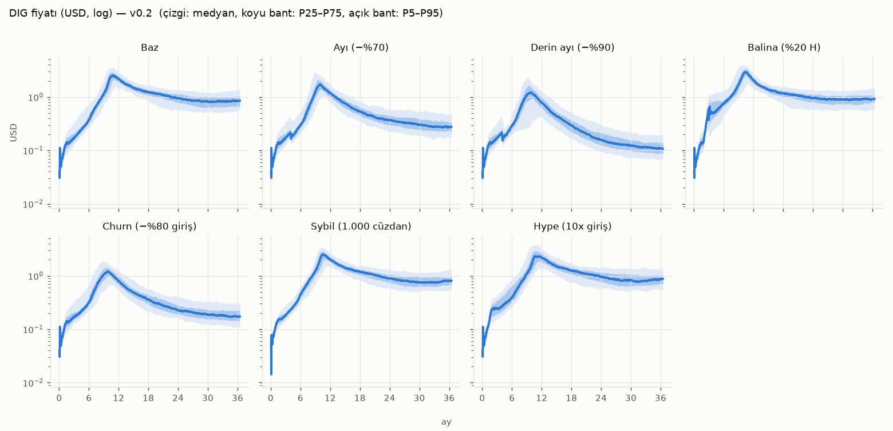
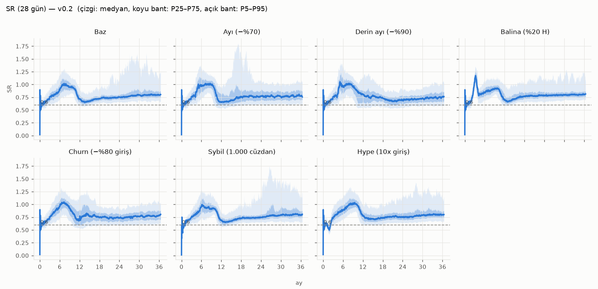

## V.2 Mint dağılımı → `DAILY_MINT_CAP` ve `hourlyMintBreaker`

Ölçüm 2.850 koşunun 3,12M koşu-gününden geliyor. Kapsam: 7 senaryo, kural kapalı varyant, tank sınırı kapalı, duyarlılık ve talep ×0,5 / ×2; market açılış günü dahil.

**Ne mint sayılır?** Mint yalnızca şunlarda olur:
- kuyruk sonlandırma,
- hızlı rafine (ücret düşüldükten sonra),
- kurucu/hazine çekimi,
- açılış LP'si.

Rafine edilmemiş bakiyeden oyun içi harcama mint değildir.

**Saatlik dağılım varsayımı** (`engine/minting.py`):
- Normal gün: gündüz eğrisi (tepe saat ortalamanın 1,8 katı).
- Açılış günü: rafine isteklerinin %50'si ilk saatte.
- Kuyruk sonlandırmaları 72 saat sonra aynı saate düşer.
- LP ve kurucu çekimi tek saatte.

| İstatistik | Günlük mint (DIG) | Günün en yoğun saati |
|---|---|---|
| Medyan | 26K | 2,4K |
| P99 | 46K | 3,3K |
| P99,9 | 69K | 21K |
| **En yüksek (açılış dahil)** | **141K** | **71K** (açılış saati: LP + ilk saat rafine) |
| Açılış günü: medyan / en yüksek | 54K / 102K | 47K / 71K |
| Açılıştan sonra en yüksek | 141K (talep ×0,5) | 23K |
| Herkes bekleyen bakiyesini aynı anda hızlı rafine etseydi (anlık potansiyel) | P95: 276K | aynı |
| Hazinenin hiç çekilmeyen birikimi | 12. ay 0,66M · 24. ay 1,22M · 36. ay 1,69M | – |

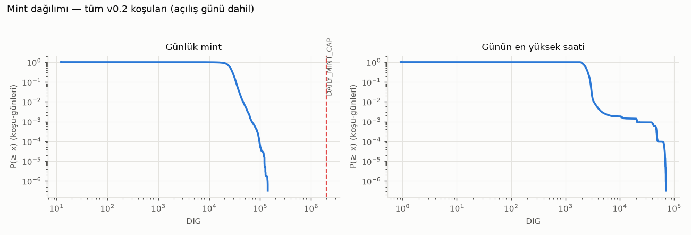

**Bulgular:**
- Günlük mint **oyuncu sayısıyla değil, emisyonla sınırlıdır.** Emisyon günde ≤ ~50K; buna birikmiş bekleyen bakiyeler ve kuyruk eklenir. Talep ×2'de en yüksek günlük mint daha düşük çıktı (80K); talep ×0,5'te daha yüksek (141K), çünkü ayrılanlar bakiyelerini boşaltıyor.
- **Açılış LP'si yapısal olarak ≈ 40K DIG'dir.** `DIG_LP = POL_ETH·ETHUSD/P0 = 0,30 × genesis tahakkuku`. §11'deki 1M tavanı formül gereği hiç bağlamaz; §2 gerekçesindeki "açılışta ≤ 1M LP" ifadesi gerçekçi değil.
- **2M tavanı en yüksek meşru günün 14 katı.** Tavan hiç bağlamadı, ama gereğinden geniş.
- **Meşru olup tavanı zorlayabilecek tek kalem hazine.** Hazine payı çekilmezse birikir (36. ayda 1,69M); tek seferde çekilirse ~1 günlük tavana denk gelir. Bu yüzden tavan, kurucu/hazine çekimlerine tranş kuralıyla birlikte önerilir.

**Öneri:**

| Parametre | Öneri | Gerekçe |
|---|---|---|
| `DAILY_MINT_CAP` (immutable) | **500.000 MOHO / UTC günü** (CAP'in %0,5'i; 2M'den düşürülür) | Gözlenen en yüksek meşru günün (141K) **3,5 katı**; P99,9'un 7 katı; "herkes aynı anda çeker" potansiyelinin (P95 276K) 1,8 katı. Bir mint hatasının günlük zararı 4 kat küçülür. **Şart:** kurucu ve hazine çekimleri istek başına ve günde ≤ **100.000 MOHO** ile sınırlanır (MiningCore kuralı). Hazine birikimi aylık/haftalık çekilir. Tavan bağlasa bile mint kaybolmaz, ertesi güne kayar; testte arz invaryantı korunuyor. |
| `hourlyMintBreaker` (MiningCore, açma yalnız Timelock) | **150.000 MOHO / kayan 60 dakika** | En yüksek meşru saatin (71K, açılış saati, LP dahil) **2,1 katı**; açılıştan sonraki en yüksek saatin (23K) 6,5 katı. Açılış LP mint'i sayaçtan muaf tutulursa 100.000'e inebilir. Bir hata durdurulmadan önce en fazla ~150K basabilir. |

**Bilinen ödünleşim:** Bütün topluluğun bekleyen bakiyesini aynı saat içinde hızlı rafine ettiği bir panik (≥ 150K/saat) kesiciyi tetikler. Açma yalnız Timelock'la (96 saat) olur, yani claim'ler 4 gün durur. Bu, kesicinin kasıtlı bir bedelidir. Simülasyonun saatlik profilinde böyle bir saat hiç oluşmadı; ama saatlik profil bir varsayımdır.

Kesinin değeri 2M'de kalmak isteniyorsa da öneri geçerli: kesici, 2M'den bağımsız olarak saatlik ilk savunma hattıdır.

## V.3 Genesis tank üst sınırının etkisi (baz, aynı 200 tohum)

| Metrik | Sınır var (v0.2) | Sınır yok |
|---|---|---|
| Genesis enerji alımı (USD) | 5.437 | 14.810 |
| **P0 (USD)** | **0,040** | 0,110 |
| Açılış POL (ETH) | **0,55** (≈ $1,6K) | 1,49 (≈ $4,5K) |
| Açılış DIG_LP | 40K | 40K |
| 1. ay ort. / tepe fiyat | $0,072 / $0,118 | $0,125 / $0,197 |
| 2. ay ort. fiyat | $0,13 | $0,32 |
| 12. / 24. ay fiyat | $2,35 / $0,98 | $2,47 / $0,96 |
| SR 12. ay | 0,72 | 0,72 |
| Geri dönüş < 365 g payı | 0,95 | 0,98 |
| Gini en yüksek | 0,74 | 0,63 |

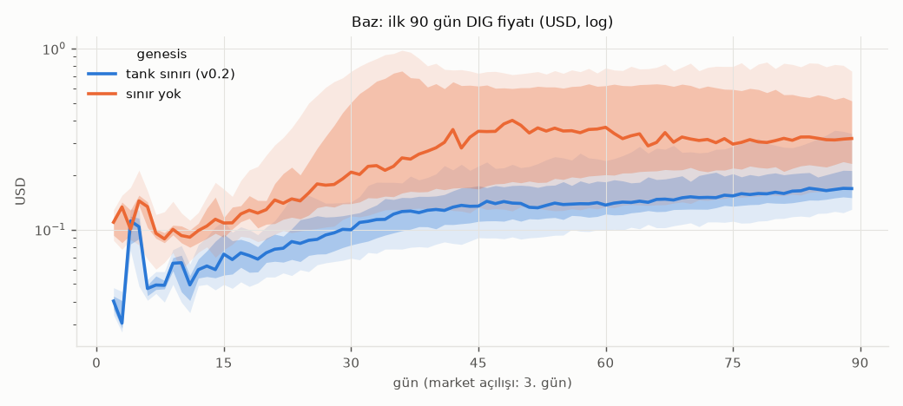
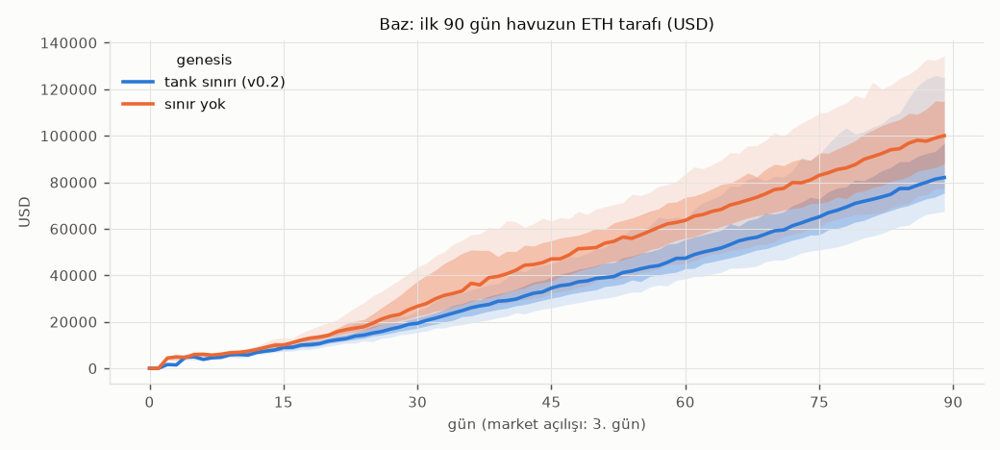

Sınır amacına ulaşıyor: genesis'te satın alınan enerji, tüketime 1 gün eklenmiş hale geliyor (≈ $5,4K'ya karşı tüketim ≈ $4K). P0 böylece madencilerin gerçek ortalama maliyetine iniyor (0,11 → 0,04).

**Bedeli:**
- Açılış havuzunun ETH tarafı 2,7 kat incelir (≈ $1,6K). DIG_LP ise aynı kalır (≈ 40K, genesis tahakkukunun %30'u).
- Fiyat açılıştan sonraki 2 gün içinde ≈ 3 katına sıçrar ($0,04 → ~$0,11), ilk iki ay daha düşük seyreder.
- 12. aydan sonra fark kaybolur.
- Gini biraz artar (0,63 → 0,74, eşiğin altında): ucuz erken MOHO, erken ve sermayeli girenleri kayırır.

24.ay/2.ay oranı bu yüzden şişer (2,8 → 7,2); kriteri "kolay geçmek" olarak okunmamalı. Sınırın 72 saate gevşetilmesi (duyarlılık) Gini'yi 0,69'a indiriyor; SR ve geri dönüş benzer. Belirgin bir üstünlük olmadığı için 24 saat korunabilir.

**Not:** Açılış havuzunun ETH tarafı dar kalıyor. "Açılış fiyatı oynaktır" iletişimi ve opsiyonel anti-snipe hook'u (§11) bu yüzden daha da önemli.

## V.4 §12 r kuralının etkisi

Kural yalnız uzun süren düşüşlerde devreye giriyor; baz, balina ve sybil'de hiç tetiklenmedi, hype'da nadiren. 36. ay sonunda r: ayıda 1.500, derin ayıda 1.000 (alt sınır), churn'de ≈ 1.125.

Aynı tohumlarla, açık / kapalı karşılaştırması:

| Metrik | Ayı | Derin ayı | Churn |
|---|---|---|---|
| VRGDA p, 24. ay (DIG/DP) | 4,29 / 3,73 | **3,15 / 0,36** | 3,17 / 2,40 |
| SR 36. ay | 0,82 / 0,78 | 0,74 / 0,69 | 0,78 / 0,74 |
| Geri dönüş < 365 g payı | 0,79 / 0,76 | 0,61 / 0,63 | 0,64 / 0,61 |
| Aktif oyuncu 36. ay | 605 / 606 | 139 / 121 | **361 / 268** |
| Gini en yüksek | 0,75 / 0,75 | 0,76 / 0,72 | **0,76 / 0,80** |
| Fiyat 24. ay | 0,376 / 0,379 | 0,170 / 0,161 | 0,240 / 0,242 |

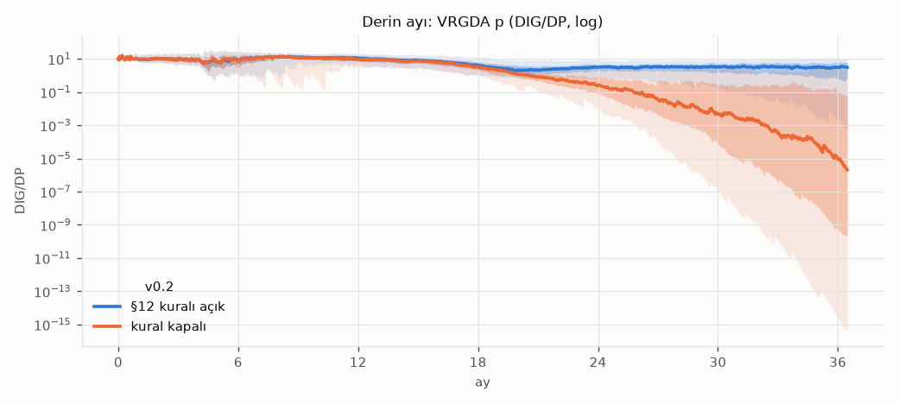
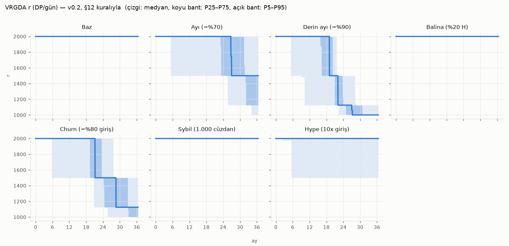

**Değerlendirme:** Etki ılımlı ve doğru yönde.
- Kural, derin ayıda makine fiyatının çökmesini önlüyor: sink sürüyor, SR 36. ayda +0,04–0,05.
- Churn'de oyuncu tutmayı artırıyor (+%35) ve Gini'yi eşiğin altına çekiyor (0,80 → 0,76).
- Fiyatı kurtarmıyor; fiyat talebe bağlı.
- Yan etki: derin ayıda Gini 0,72 → 0,76. Daha pahalı kalan makineler sermayeli oyunculara kayıyor.

**96 saatlik timelock:** Aynı 50 tohumda gecikmeyi 72 → 96 saate çıkarmak, r yolunu hiçbir senaryoda değiştirmedi. Metrik farkları ≤ 0,03 (örneğin ayıda SR 36. ay 0,83 → 0,80; derin ayıda VRGDA p 24. ay 3,31 → 3,06). Haftalık kontrol + 30 günlük bekleme yanında 1 günün etkisi önemsiz.

**Kontrat gereği (önemli):** r'yi ham formülde değiştirmek fiyatı sıçratır. 1M DP satılmışken r'yi %25 indirmek takvimi ~167 gün öteler; fiyat ×0,85⁻¹⁶⁷ olur. Kural ancak **fiyat sürekli yeniden çapalama** ile uygulanabilir:

```
p = p0·(1−k)^(s_a + (t−t_a) − (n−n_a)/r)
```

Değişiklik anında `s_a, t_a, n_a` güncellenir. Simülasyon bunu kullanıyor; vektörler: `vectors/vrgda_reanchor.json`.

## V.5 Kalan parametre önerileri (ölçülmüş etkiyle)

**Baz, değer başına 50 tohum** (v0.2 değeri tabloda işaretli; `results/v02/tables.md`):

| Ayar | Değer | SR 12. ay | Geri dönüş < 365 g | 24.ay/2.ay | Oyuncu 12. ay | Gini en yüksek |
|---|---|---|---|---|---|---|
| r | 1.000 | **0,84** | 0,91 | 5,0 | 12,5K | **0,61** |
| r | 1.500 | 0,76 | 0,94 | 6,4 | 11,5K | 0,69 |
| r | **2.000 (v0.2)** | 0,70 | 0,96 | 7,3 | 10,7K | 0,73 |
| r | 3.000 | 0,71 | 0,93 | 6,9 | 9,4K | 0,76 |
| k | 0,10 | 0,76 | 0,78 | 6,9 | 8,9K | 0,76 |
| k | 0,25 | 0,68 | 1,00 | 7,3 | 11,7K | 0,68 |
| ETH dağılımı | 60/30/10 | 0,71 | 0,99 | 8,7 | 10,7K | 0,71 |
| Genesis tank sınırı | 72 saat | 0,74 | 0,94 | 6,2 | 11,4K | 0,69 |

**Talep sağlamlığı (baz, 50 tohum):**

| Talep | SR 12. ay | Geri dönüş | Oyuncu 12. ay | En yüksek günlük mint (P95) |
|---|---|---|---|---|
| ×0,5 | 0,67 | 0,87 | 4,9K | 123K |
| ×2 | 0,90 | 0,94 | 25K | 75K |

Her iki uçta tüm kriterler geçiyor.

**Değerlendirme:**
1. **`r = 2.000` korunsun.** r = 1.000–1.500 SR ve Gini'de daha iyi, ama geri dönüş ve 24. ay fiyatı biraz daha düşük; yönetişimin aşağı ayar payı da daralır. §12 kuralı stres senaryolarında r'yi zaten bu bölgeye indiriyor; başlangıç değerini değiştirmeye gerek yok.
2. **`k = 0,15` korunsun.** 0,25 geri dönüşü ve Gini'yi iyileştiriyor ama SR'yi düşürüyor (0,68). 0,10 geri dönüşü bozuyor. Net üstünlük yok.
3. **ETH dağılımı 55/30/15 korunsun.** 60/30/10 hafifçe daha iyi (geri dönüş 0,99, Gini 0,71). Ama derin ayıda 36. ay ops geliri P5 ≈ $5,4K/ay'dan ≈ $3,6K/ay'a iner; bu kurucunun bütçe kararıdır.
4. **Genesis tank sınırı 24 saat korunsun.**
5. **Gerçek değişiklik önerileri mint güvenliği ve dokümantasyondadır:** §V.2 ve §V.6.

## V.6 docs/02 için önerilen düzenlemeler (kurucu onayına)

| Bölüm | Şimdiki | Önerilen |
|---|---|---|
| §2 tablo "Günlük mint tavanı" + Invariant T3 | 2.000.000 MOHO / UTC günü (%2 CAP) | **500.000 MOHO / UTC günü (%0,5 CAP), immutable.** Gerekçe metni: "en yüksek meşru gün 141K (3.240 koşu); açılış LP'si ≈ 40K". "≤ 1M LP" ifadesi kaldırılsın. |
| §2 (yeni satır) veya 03 §3.3 / 04 §5.2 | `hourlyMintBreaker` değeri yok | **150.000 MOHO / kayan 60 dakika.** Açılış LP mint'i sayaçtan muafsa 100.000. Aşılırsa mint yolları durur, açma yalnız Timelock. |
| §3.3 "Kurucu ve hazine çekimleri" | yalnız 72 saatlik kuyruk | Ek: **çekim başına ve günde ≤ 100.000 MOHO** (tranş). Hazine en az aylık çeker; birikim mint tavanını zorlamasın. |
| §6.2 / §12 (r değişikliği) | r ±%25 / 30 gün | Ek: **"r değişikliği fiyat sürekli yapılır (yeniden çapalama: s_a, t_a, n_a), aksi halde fiyat sıçrar"** + formül (V.4) + `vectors/vrgda_reanchor.json`. |
| §11 DIG_LP | `min(…, 1,000,000)` | Not: formül gereği `MOHO_LP = 0,30 × genesis madenci tahakkuku ≈ 40K`; 1M tavanı bağlamaz. Açılış havuzunun ETH tarafı tank sınırıyla ≈ 0,5 ETH. "Açılış fiyatı oynaktır" iletişimi ve anti-snipe hook kararı buna göre. |
| §11 genesis tank sınırı | Market Open + 24 saat | Değer korunsun; gerekçeye ölçülen etki eklensin: P0 0,11 → 0,04, açılış havuzu ETH 1,49 → 0,55, ilk 2 ay fiyat daha düşük, 12. aydan sonra fark yok. |
| §12 müdahale kuralı | metin | Korunsun (simülasyonda faydalı ve güvenli); gecikme 96 saat sorun değil. "Haftalık ölçüm" ifadesi eklensin: 4 hafta = 4 ardışık haftalık SR / ortalama p/p0. |
| §13 tablo, v0.2 sütunu | "GEÇTİ (0,97; medyan 79 gün)" vb. (v0.1 önerilen setin sonuçları) | v0.2 tam setiyle ölçülenler: geri dönüş **0,95 (medyan 96 gün)**, SR **0,72 / 0,65**, Gini **7/7 (en yüksek 0,775)**, sybil **1,026**. v1.0 öncesi "tank sınırı simülasyona eklenecek" notu kapatılabilir. |

Ham tablolar: `sim/results/v02/tables.md`. Yeniden üretim: `sim/README.md`.

---

# v0.1 çalışması: DIG Ekonomisi — Monte Carlo Simülasyon Raporu (şartname v0.1)

> Aşağıdaki bölümler v0.1 parametreleriyle yapılan ilk çalışmadır (tarihsel kayıt; sonuçlar `results/`, `charts/` kökünde). Güncel durum için yukarıdaki "v0.2 doğrulaması"na bakın.

> **Kapsam:** `docs/02_TOKENOMI_VE_OYUN_MATEMATIGI.md` (v0.1) için ajan tabanlı, günlük adımlı Monte Carlo simülasyonu. Şartname değiştirilmedi; bu rapor yalnızca **öneri** yapar.
>
> **Kod adı:** Token bu raporda ve kodda `DIG` olarak geçer (nihai ticker büyük olasılıkla **$MOHO**).
>
> **Koşu sayıları:**
> - Şartname parametreleri: 7 senaryo × **200 tohum**
> - Önerilen parametreler: 7 × 100 tohum
> - Duyarlılık: değer başına 50 tohum
> - Talep kalibrasyonu: 25 tohum
> - Tanılar: 20 tohum
> - Toplam ≈ 3.060 koşu, 14 çekirdekli dizüstünde ≈ 26 dakika
>
> Hedeflenen 15 dakika aşıldı. Şartnamenin istediği 200 tohum korundu, diğer bölümlerde tohum sayısı düşürüldü. Tohum *i* her yapılandırmada aynı rastgele akışı kullanır (ortak rastgele sayılar); yapılandırmalar arasındaki farklar bu yüzden tohum gürültüsü değildir.
>
> **Yeniden üretim:** `sim/README.md`. Tüm sayılar `sim/results/` altındaki JSON dosyalarından; tablolardaki ondalık ayırıcı noktadır.

## 1. Özet

**Şartname v0.1 ile ana bulgular:**

1. **VRGDA `r = 8.000 DP/gün`, enerji dengesine göre çok yüksek; tasarımdaki en büyük kusur bu.**
   - Ağ, enerji maliyetiyle sınırlı olduğu için birkaç yüz bin aktif DP taşıyabiliyor: bazda 12. ayda ≈ 460 bin, 36. ayda ≈ 210 bin.
   - VRGDA ise yılda 2,9M DP satışı hedefliyor. Satış hedefin gerisinde kaldıkça makine fiyatı günde %15 düşüyor: bazda 12. ayda p0'ın %5'i; ayı, derin ayı ve churn'de 24. ayda fiilen sıfır.
   - Makine bedavalaşınca ana DIG sink'i ortadan kalkıyor. Ağ ucuz DP ile şişiyor, getiri enerjiyle sıfıra rekabet ediliyor.
   - Sonuç: **kohortların yalnız %15'i giriş yatırımını 365 günde DIG cinsinden geri alıyor; cüzdanların %73'ü 3 yılda hiç geri alamıyor.**
2. **Ponzi testi (RCR ≥ s) bütün senaryolarda başarısız; bu yapısal bir sonuç.** Serbest giriş dengesinde enerji gideri madenci gelirine yaklaşır, buyback de onun yalnız %40'ıdır. Dolayısıyla P* ≤ 0,36·P'dir. Sıfır net emisyon ancak harcama yakımı emisyonun ≳ %64'ünü karşılarsa mümkündür. Bu, ancak VRGDA çökmezse olur. Bazda 12. ayda RCR = 0,36, s = 0,80; fiyat P*'ın ≈ 2,7 katı.
3. **Sink oranı hedefi tutuyor.** 12. ayda SR bazda 0,70, ayıda 0,56. 3 yılda basılan 42,7M DIG'in 28,2M'i kalıcı yakılıyor; bunun büyük kısmı erken dönem makine/üs harcaması ve buyback'ten geliyor.
4. **Açılış havuzu çok sığ.** `DIG_LP` formülü fiilen "genesis tahakkukunun %30'u" demektir: ≈ 40 bin DIG'e karşı ≈ $4,7 bin ETH. Fiyat ilk haftalarda P0'ın 2–3 katına çıkıyor, kötü %5'lik dilimde 20 katı aşıyor.
5. **Talep düşerse hashpower yoğunlaşıyor.** Ayı ve churn senaryolarında Gini 0,8'i aşıyor; 36. ayda H'nin yarısını 2 cüzdan tutuyor (Nakamoto = 2).
6. **Sybil-nötrlük tezi doğru.** Hesap bölmek kWh başına emisyonu değiştirmiyor (aynı gün ve aynı makineyle 1,006). Ancak şartnamenin ölçütü (ömür boyu emisyon payı / enerji payı) zamanlamayla karışıyor ve 2,29 çıkıyor: sybil yalnız genesis'te kazıyor. Ücretsiz Auger yine de sermayesiz bir giriş veriyor.
7. **Ops gelirinin büyük kısmı DIG piyasasından sızıyor.** Gelir bazda 12. ayda ≈ $176 bin/ay; varsayılan maliyet $15 bin/ay. Bu fazla DIG'e geri dönmüyor.

**Kabul kriterleri (şartname §13):**

| Kriter | Şartname v0.1 | Önerilen parametreler |
|---|---|---|
| P(24. ay fiyatı > %30 × 1. ay ort.) ≥ 0,5 (baz) | **GEÇTİ** (0,955) | **GEÇTİ** (1,00) |
| ≥ %70 kohortta medyan DIG geri dönüşü < 365 gün (baz) | **KALDI** (0,15) | **GEÇTİ** (0,97; medyan 79 gün) |
| SR 12. ay ≥ 0,6 (baz) | **GEÇTİ** (0,70) | **GEÇTİ** (0,72) |
| SR 12. ay ≥ 0,3 (ayı / derin ayı) | **GEÇTİ** (0,56 / 0,50) | **GEÇTİ** (0,72 / 0,78) |
| Hashpower Gini < 0,8 (3–36. ayların en yükseği, 7 senaryo) | **5/7** (ayı 0,87, churn 0,82 KALDI) | **6/7** (churn 0,800, sınırda KALDI) |
| Sybil emisyon payı / enerji payı ≈ 1 | Şartnamedeki ölçüt: **KALDI** (2,29). Aynı gün karşılaştırması: **GEÇTİ** (1,006) | **GEÇTİ** (0,91 / 1,026) |
| Ops ETH runway > 12 ay (en kötü %5 hariç) | **GEÇTİ** (her senaryoda sonsuz) | **GEÇTİ** (sonsuz) |
| *Ek:* Ponzi testi RCR ≥ s (§10) | **KALDI** (0,36 < 0,80) | **KALDI** (0,15 < 0,36) |

**Önerilen değişiklikler (§7):** Her ikisi de şartnamenin zaten ayarlanabilir tuttuğu sınırlar içindedir.

1. **VRGDA `r`: 8.000 → 2.000 DP/gün.** Duyarlılık analizindeki tek başına etkisi:
   - geri dönüşü 365 günün altında olan kohort payı 0,14 → 0,69;
   - SR 0,65 → 0,78;
   - 12. aydaki aktif oyuncu 3,7 bin → 12 bin.
2. **ETH gelir dağılımı: buyback / POL / ops = 40/30/30 → 55/30/15.**
3. **§12 müdahale politikasının yönü düzeltilmeli.** "SR < 0,5 → r artır" yanlış yön: simülasyonda r büyüdükçe SR ve geri dönüş düşüyor.
4. **§13 ölçütlerinin tanımları netleştirilmeli:** geri dönüş tanımı, sybil ölçütü, fiyat kriterinin referans ayı.

**Önemli uyarı:** Mutlak fiyatlar uydurma bir talep kalibrasyonuna dayanır (§3). Önerilerin yönü, talebi yarıya indirmek ya da ikiye katlamak altında da korunuyor (§8). Seviyeler korunmuyor.

## 2. Model: ne simüle ediliyor?

Simülasyon, şartnamedeki formülleri **birebir** kullanan, günlük adımlı (1.095 gün = 3 yıl), kohort tabanlı ajan modelidir (`engine/model.py`). Bir **kohort**, aynı gün katılan ve aynı tipteki cüzdanların grubudur. Balina, bot çiftliği ve sybil operatörü birden çok cüzdanlı tek bir kohorttur. Makine sayıları ve üs seviyesi cüzdan başına, bakiyeler (DIG, ETH, enerji tankı) kohort toplamı olarak tutulur. Makine sayıları süreklidir: "cüzdan başına 0,3 makine", kohortun %30'unun bir makine aldığı anlamına gelir. Yarım cüzdandan az kalan kohort tamamen çıkmış sayılır ve kaydı payback istatistikleri için arşivlenir.

### 2.1 Bir günün sırası

1. **Dışsal girdiler:**
   - ETH/USD rastgele yürüyüşü.
   - Yeni oyuncular: lojistik benimseme dalgası, sürekli keşif kuyruğu, AR(1) gürültüsü ve senaryo şokları. Her yeni cüzdan 1 ücretsiz Hand Auger ile L1 üssü alır ve 7 günlük enerji tankını doldurur.
2. **İşletme (§5):** Her (ajan tipi, makine tier'ı) sınıfı için başabaş maliyeti `c = π·24/η` USD/DP/gün'dür. Bu maliyetler **merit order** ile sıralanır ve serbest giriş dengesi `H* = 0,9·E·P / c_marjinal` çözülür: verimli tier'lar önce çalışır, marjinal sınıf kısmen çalışır. Gündelik oyuncular %20 zarara kadar makinelerini açık tutar ("dikkatsizlik"). Genesis'te herkes çalışır. Gerçek aktif DP, ön ödemeli tankla sınırlıdır.
3. **Emisyon (§3, §9):** `E = R·δ_d`; bu, 24 saatlik dönemin bileşik toplamına tam eşittir. Dağıtım:
   - %90 aktif DP'ye pro-rata;
   - %5 kurucu;
   - %5 hazine. Referans kredisi (%3) hazine payından ödenir. Koşullar: davet edilenin enerjisi ≥ 0,003 ETH ve davet eden aktif.
4. **Capex planı (§6, §7):** Her kohort günde en fazla 3 kez üç eylemi karşılaştırır:
   - boş slota makine almak;
   - bir tier'ın kilidini açan seviyeye kadar **tüm yükseltme yolunun** maliyetini hesaba katıp bir seviye çıkmak;
   - slot doluysa en kötü makineyi %20 hurda kredisiyle söküp daha iyisini almak.

   Seçim ölçütü, araştırma notundaki **büyüme düzeltmeli DIG geri dönüşüdür**: `τ = −ln(1 − g·τ_statik)/g`, `g = gözlenen H büyümesi + λ`. `g·τ_statik ≥ 1` ise yatırım hiç geri dönmez. Eylem, τ tipin eşiğinin (`tau_max`) altındaysa yapılır. Ödeme sırası: hurda kredisi, rafine edilmemiş DIG, cüzdan DIG'i, sonra ETH ile AMM'den DIG alımı.
5. **Kozmetik:** Önce rafine edilmemiş DIG, sonra cüzdan, sonra AMM'den alım; %100 yakılır.
6. **Rafineri (§8):** Genesis'te kapalıdır. Hızlı ya da 72 saatlik kuyruk seçimi sabırsızlığa göre yapılır: `ücret < ρ·3 gün` ise hızlı, karar lojistik olarak yumuşatılmıştır. Hızlı ücretin yarısı yakılır, yarısı rezerve döner.
7. **Piyasa (gün 3'ten itibaren):** Satış emirleri:
   - kohortların rafine edilen DIG'den tipe göre satışları;
   - enerji tankı için gereken ETH'yi karşılayan zorunlu satışlar;
   - ayrılanların boşaltması;
   - kurucu satışı (yalnız 72 saatlik kuyruktan çıkanın %50'si);
   - spekülatör satışları.

   Alım emirleri: capex ve kozmetik DIG alımları, spekülatörler ve dünkü gelirden buyback (günlük tavan: havuz ETH'sinin %2'si). Hepsi sabit çarpımlı havuzda 8 dilimde, karışık sırayla işlenir. Ardından dünkü POL payı tek taraflı ETH olarak havuza eklenir (zap).
8. **Enerji tankı dolumu:** ETH ile yapılır. Bu, protokolün dış gelirini oluşturur ve %40 buyback, %30 POL, %30 ops olarak bölünür (§10).
9. **Capex ödemesi:**
   - Önce üs, sonra makineler. Makineler o günün VRGDA partisinden alınır; partinin gün içine yayıldığı varsayılır ve kapalı formu `engine/vrgda.py: day_cost`'tadır.
   - Harcanan DIG'in %80'i kalıcı yakılır, %20'si rezerve döner (§6.3).
10. **Gün sonu:** ops maliyeti, ayrılmalar (churn), gün 2 sonunda market açılışı (§11: `P0 = genesis enerji USD / genesis madenci tahakkuku`, `DIG_LP = min(POL_ETH·ETHUSD/P0, 1M)` rezervden basılır), metrikler ve **arz invaryantı** kontrolü.

### 2.2 Ajan tipleri (§13)

| Tip | Bütçe | Davranış |
|---|---|---|
| Sıradan madenci | $150, %60'ı capex | Geri dönüş ≤ 180 gün ise alır. Büyümeyi yarı ağırlıkla görür, rafine edileni %70 satar. Kârsızken %20 toleransla çalıştırır. Günlük %0,6 ayrılma riski vardır; makinelerin yarısından fazlası kapalıysa 5 katına çıkar. |
| Yeniden yatırımcı (optimizer) | $800, %70 capex | Geri dönüş ≤ 270 gün; kazandığını oyunda harcar, %30 satar, tam rasyonel çalıştırır, %0,2/gün ayrılma. |
| Balina | ~$60K (log-normal), 5 hesap | Geri dönüş ≤ 150 gün. Zirveden %50 düşüşte her şeyi satıp çıkar. Ayda yaklaşık 1 balina gelir. |
| Bot çiftliği | $4K, 50 cüzdan | Kazandığını yeniden yatırmaz. Rafine edilenin %100'ünü, çoğunlukla hızlı rafineyle satar. |
| Kozmetik harcayan | $150 + günde $0,30 kozmetik | Gündelik madenci gibidir, ek olarak kozmetiğe DIG yakar. |
| Spekülatör/LP | Toplu ajan | Madencilik yapmaz. Pozisyon hedefi (USD) = 25 $ × aktif oyuncu × duygu × momentum × "değer". Değer çarpanı = (üretim maliyeti / fiyat)^0,5, [0,1; 10] aralığında sınırlı. Hedefe günde %10 yaklaşır. Likidite sağlamaz (aşağıya bakın). |

Bütün kararlar yalnızca **gözlenebilir** duruma dayanır: E, H ve son 7 gündeki büyümesi, VRGDA fiyatı, AMM spot fiyatı ve 30 günlük ortalaması, enerji fiyatı, ETH/USD. Kimse geleceği bilmez; özellikle kimse başkalarının yarınki alımlarını öngöremez.

## 3. Varsayımlar ve modelin yakalayamadıkları

**Bu bir tahmin değil, bir stres düzeneğidir.** Mutlak fiyat seviyeleri tamamen talep kalibrasyonuna bağlıdır ve bu kalibrasyon için gerçek veri yoktur. Güvenilir olan şey, **aynı tohumlarla** yapılan karşılaştırmalardır: senaryo A ile B, parametre X ile Y. Talep varsayımını yarıya indirmek ya da ikiye katlamak sonuçları nasıl değiştiriyor, §8'de gösterilmiştir.

| Varsayım | Değer | Etki / not |
|---|---|---|
| Talep | Genesis'te 2.000 cüzdan. Lojistik dalga 20.000 oyuncu (tepe: 150. gün). Sonrasında farkındalıkla ölçeklenen günde 25 yeni oyuncu. Senaryo şokları bu akışı çarpar. | **En kritik ve veriyle doğrulanmamış girdi.** |
| ETH/USD | $3.000'den başlar; günlük %2 oynaklıkla medyanı koruyan rastgele yürüyüş. DIG ile korelasyonu yoktur. | Bir ETH çöküşü + DIG düşüşü korelasyonu modellenmedi. |
| Ops maliyeti | Aylık $15.000 | Runway buna doğrusal bağlıdır; ops gelirini de raporluyoruz. |
| Kurucu satışı | 72 saatlik kuyruktan çıkanın %50'si | Şartname yalnızca "politika yayımlanır" diyor. |
| Hazine | Hiç çekilmez; yalnız referans ödenir. | Sezon ödülleri dağıtılırsa ek satış baskısı oluşur. Bu baskı modelde yok, yani **iyimser**. |
| P0 tabanı | Genesis'te **satın alınan** enerji (tank ön doldurması dahil) | "Tüketilen" seçeneği P0'ı yaklaşık 3–4 kat düşürür; DIG_LP değişmez (§4.5). |
| Genesis buyback payı | Genesis gelirinin %40'ı birikir, açılıştan sonra günlük tavanla geri alınır. | Şartname tanımlamıyor. |
| Likidite | Yalnız POL (tam aralık, v2 matematiği, %0,3 ücret havuzda kalır). Üçüncü taraf LP, CEX, başka havuz ve arbitraj yok. | Derinlik için **alt sınır**. |
| Alıcı davranışı | İsteğe bağlı alımlar günde havuz ETH'sinin en fazla %10'u kadar (≈ %21 fiyat etkisi). | Bu sınır olmadan açılışta ince havuzda 100x'lik "pump"lar çıkıyordu. |
| Fiyat tepkisi | Fiyat 30 günlük ortalamanın üstündeyken daha çok rafine edilir ve satılır (4 katında tam). Altındayken satışların en fazla yarısı ertelenir. | Kâr realizasyonu / "HODL" sezgisi. |
| Tank | Herkes 7 günlük enerjiyi önceden alır; tank iade edilmez. | Ayrılanların tankı yanar (protokol için zaten gelir). |

**Modelin yakalayamadıkları (dürüst liste):**

- **Davranış:** Sosyal dinamik, KOL/haber, FOMO dalgaları, rakip oyunlar ve "eğlence için" para harcayan oyuncu yok. Herkes geri dönüş eşiğine bakar. Alım kararı gelecekteki ağ büyümesini yalnızca geçmiş 7 güne bakarak tahmin eder.
- **Zaman çözünürlüğü:** Saatlik dönemler, tank bitiş saatleri (`dpEndingAt`), gün içi sıralama, MEV/sandviç ve keeper gecikmesi yok. Gün içindeki her şey ortalama fiyattan işler.
- **İçerik:** Yeni makine nesilleri (stratum eşikleri, §3.4) **yok**. 3 yıl boyunca yalnız Gen-1 var. Gerçekte yeni nesil, yerleşik DP'yi değersizleştirip yeniden yatırım talebi yaratır.
- **Kohortlar:** Kohort içi heterojenlik yok. Makine sayıları süreklidir. Üs seviyesi kohort içinde tamsayıdır (herkes birlikte yükseltir).
- **Spekülatörler:** Tek toplu ajan; kaldıraç, açığa satış ve likidite sağlama yok.
- **Balina senaryosu:** Balina AMM'den günde havuzun %10'undan fazla alamadığı ve üs maliyeti dışbükey olduğu için 30 günde **hedeflenen %20 H'ye ulaşamıyor** (§4). Bu bir bulgudur, ama "%20'yi bir günde alan balina" stresini tam olarak sınamaz.
- **Kapsam dışı:** Hukuki/regülasyon riski, akıllı kontrat hataları, oracle arızası.

### 3.1 Doğrulama

- **Birim testleri:** `python -m unittest discover -s tests -t .` ile 32 test geçiyor:
  - emisyon tablosu §3.2 ile, rakamların basılı hassasiyetine kadar örtüşüyor;
  - VRGDA kapalı formu, birim fiyat toplamına 1e-10 içinde eşit;
  - günlük parti maliyeti, ince sıralı alımlara 1e-7 içinde eşit;
  - pro-rata dağıtım emisyonu koruyor;
  - hesap bölmek ETH başına emisyonu değiştirmiyor;
  - vektörler yeniden üretilebilir.
- **Arz invaryantı (E2):** `dolaşım + pending (oyuncu + kurucu + hazine) + rafine kuyrukları + R + burnedForever = CAP` her gün kontrol edildi. Raporda kullanılan tüm koşularda en büyük sapma **9,5e-7 DIG**; bu, 100M'lik tavanda kayan nokta tozudur.
- **Altın vektörler:** `vectors/` klasöründe; tamsayı algoritmaları `vectors/README.md`'de belgelendi.

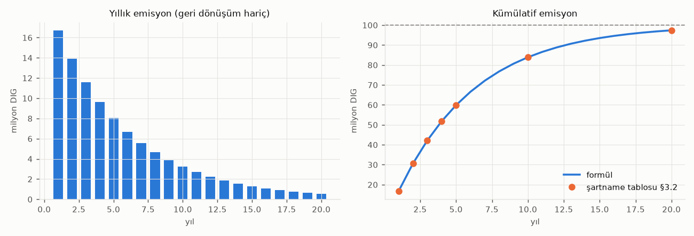

*Formüldeki yıllık ve kümülatif emisyon (çizgi/çubuk) şartname §3.2 tablosuyla (noktalar) örtüşüyor.*

## 4. Sonuçlar — şartname v0.1 parametreleri

Senaryo başına 200 tohum. Değerler **medyan [P5–P95]** biçimindedir; tam tablo §4.9'da. Grafiklerdeki çizgi medyanı, koyu bant P25–P75'i, açık bant P5–P95'i gösterir.

### 4.1 Genesis ve market açılışı

| | Baz |
|---|---|
| P0 (USD) | 0,116 [0,098–0,134] |
| Açılışta POL | 1,57 ETH (≈ $4.700) |
| DIG_LP | 40.500 DIG |
| 1. ay ortalama fiyat | $0,245 [0,14–0,98] |
| 1. ay tepe | $0,37 [0,19–2,69] |

- **DIG_LP formülü yapısal olarak genesis tahakkukunun %30'una eşittir** (POL'a giden pay %30 olduğu için): `DIG_LP = 0,3·genesis enerji USD / P0 = 0,3·genesis tahakkuku` (enerji USD kısalır). Genesis'te ≈ 135.000 DIG tahakkuk eder; havuza yalnız ≈ 40.000 DIG ve ≈ $4.700'lük ETH girer.
- Havuz, oyuncuların rafine edilmemiş genesis bakiyelerine ve ilk günlerin alım talebine göre **çok sığdır**. Fiyat ilk haftalarda P0'ın 2–3 katına çıkar, kötü %5'lik dilimde 20 katı aşar.
- Rafineri genesis'te kapalı olduğu için tahakkuk eden DIG'in büyük kısmı oyun içinde makine ve üse harcanır. Bu da açılıştaki satış baskısını sınırlar.

### 4.2 Fiyat yolları

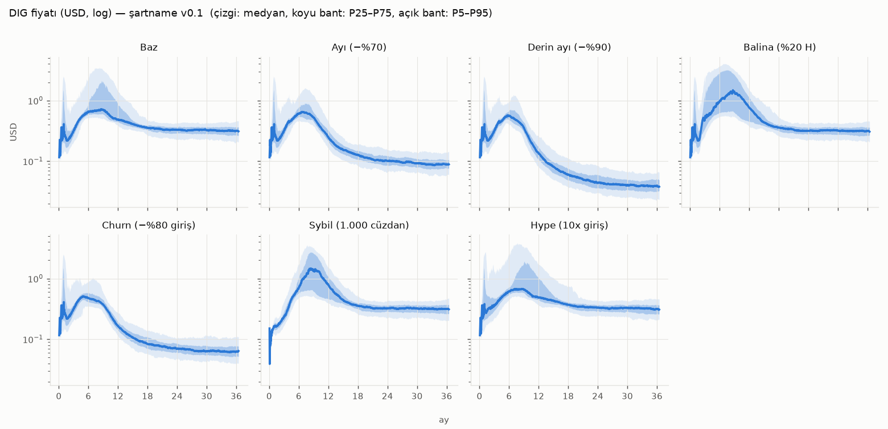

| Senaryo | 12. ay | 24. ay | 36. ay | 24.ay / 1.ay |
|---|---|---|---|---|
| Baz | $0,48 [0,42–1,71] | $0,34 [0,23–0,42] | $0,31 | 1,19 [0,31–2,40] |
| Ayı (−%70, 4. ay) | $0,29 | $0,10 [0,07–0,16] | $0,09 | 0,37 |
| Derin ayı (−%90) | $0,15 | $0,045 [0,03–0,09] | $0,04 | 0,17 |
| Churn (yeni giriş −%80, 3. ay) | $0,19 | $0,071 | $0,06 | 0,26 |
| Balina, hype | baza yakın (12. ayda balinada $0,88) | | | |

Bazda fiyat 6–10. aylarda tepe yapar: benimseme dalgası, kapasite kıtlığı ve VRGDA'nın henüz çökmemiş olması bir aradadır. Sonra yaklaşık $0,3'te dengelenir. Talep şokları kalıcı bir seviye düşüşü yaratır ve fiyat toparlanmaz. Bunun nedeni, emisyonun talepten bağımsız olarak madencilere akmaya devam etmesidir.

### 4.3 Hashpower, oyuncular ve VRGDA

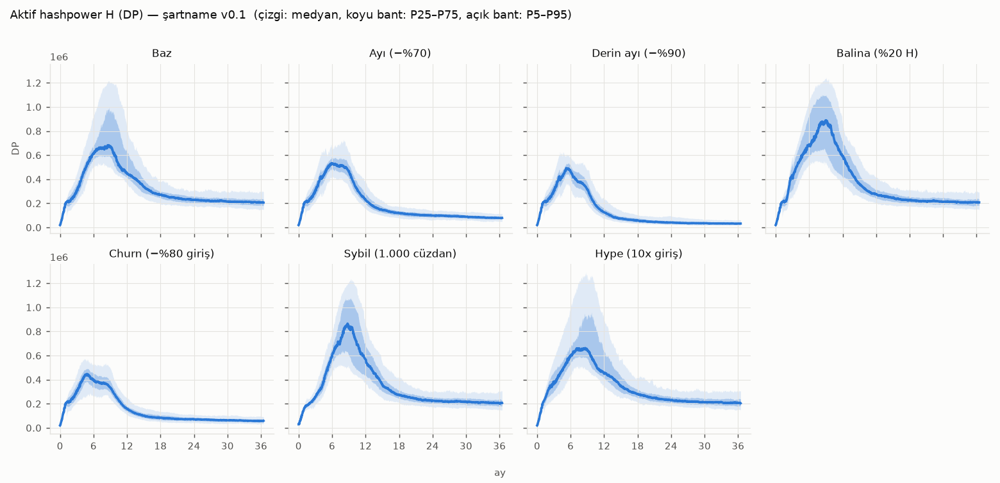 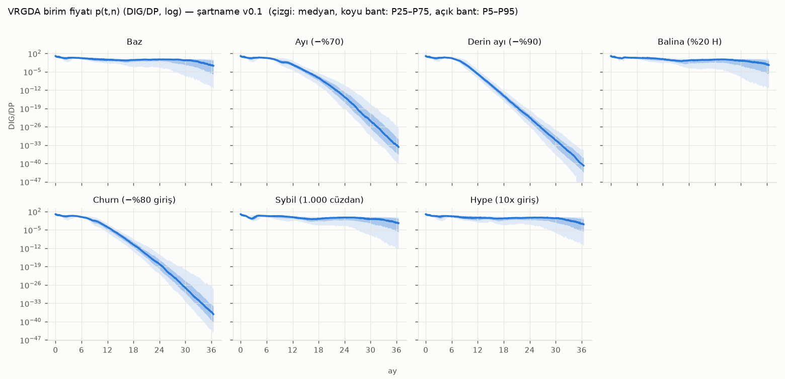 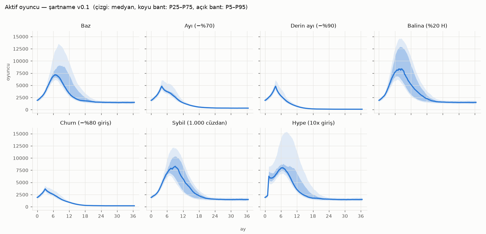

- **Aktif H, enerji dengesiyle sınırlı kalıyor:** bazda 12. ayda ≈ 460 bin DP, 36. ayda ≈ 210 bin DP. Bu, şartnamenin §5.2 örneğindeki `H* ≈ 140.600 DP` ile aynı mertebededir.
- **VRGDA'nın r = 8.000 DP/gün hedefi bu dengeyle uyumsuz:** 3 yılda 8,8M DP satışı varsayar, ağ ise birkaç yüz bin aktif DP taşıyabiliyor.
- **Sonuç: fiyat çöküşü.** Satışlar hedefin gerisinde kaldığından p(t,n) günde %15 düşer.
  - Bazda medyan p(t,n) 6. ayda 1,9, 12. ayda 0,49 DIG/DP'dir (p0 = 10).
  - Ayı, derin ayı ve churn senaryolarında 24. ayda 1e-14'ün altına iner: makineler fiilen bedava olur.
  - Bu durumda makine harcaması sink olmaktan çıkar. Ağ ucuz makinelerle aşırı kurulur, getiriler enerjiyle sıfıra rekabet edilir, gelen oyuncu kârlı yatırım bulamaz ve ayrılır.
- **Oyuncu sayısı:** bazda 12. ayda ≈ 3.700, 36. ayda ≈ 1.500. Ayıda 36. ayda ≈ 320, derin ayıda ≈ 90.

### 4.4 Emisyon ve yakımlar: SR, NE, RCR, P*

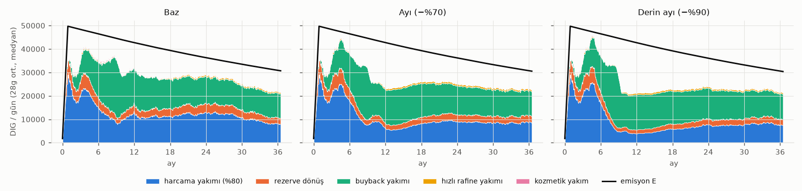 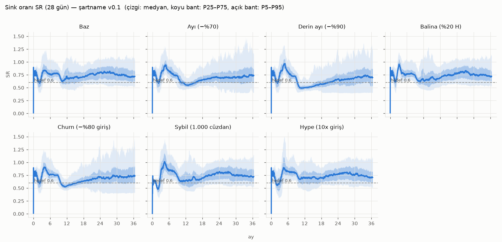

| Metrik | Baz | Ayı | Derin ayı |
|---|---|---|---|
| SR 12. ay (yakım + rezerve dönüş) | 0,70 [0,48–1,08] | 0,56 | 0,50 |
| SR 12. ay (yalnız yakım) | 0,62 | 0,51 | 0,46 |
| NE 12. ay (28 gün toplamı) | ≈ +451 bin DIG (≈ +16 bin DIG/gün) | +591 bin | +643 bin |
| RCR 12. ay | 0,36 | 0,34 | 0,35 |
| s 12. ay (DEX'te satılan / basılan) | 0,80 | 0,87 | 0,89 |
| P* 12. ay | $0,18 (fiyat $0,48) | $0,09 | $0,05 |
| 3 yılda basılan / kalıcı yakılan | 42,7M / 28,2M | 42,6M / 26,9M | 42,6M / 25,5M |

- Net emisyon pozitif, ama 3 yılda basılanın ≈ %66'sı kalıcı yakılıyor. Bunun büyük kısmı, ilk ayların yüksek VRGDA fiyatında yapılan makine ve üs harcamaları ile buyback'ten geliyor.
- **Ponzi testi (RCR ≥ s) tüm senaryolarda başarısız:** gelirin buyback'e giden kısmı, emisyonun satılan kısmını karşılamıyor (RCR ≈ 0,36 < s ≈ 0,8). Fiyat P*'ın ≈ 2,7 katı.
- **Satış akışı (ilk yıl, baz, 20 tohum, `results/details.json`):**
  - Emisyonun %64'ünü oyuncu cüzdanları DEX'te satıyor; %30'u buyback ile geri alınıp yakılıyor.
  - Ayrılanlar %2,4, kurucu %2,5, spekülatörler %3 satıyor.
  - USD olarak: emisyonun değeri ≈ $9,8M. Buna karşı oyuncuların DIG alımı ≈ $2,2M, buyback ≈ $3,1M, POL ≈ $2,3M ve ops'a giden ≈ $2,3M.
- **Bu sonuç yapısaldır.** Serbest giriş dengesinde enerji gideri madenci gelirine yaklaşır, buyback de enerjinin yalnızca %40'ıdır. Dolayısıyla `P* = 0,4·R_ETH/E ≤ 0,4·0,9·P`, yani **P* her zaman P'nin altında kalır**. Sıfır net emisyon ancak harcama yakımı emisyonun ≳ %64'ünü karşılarsa mümkündür, bu da VRGDA'nın çökmemesini gerektirir (§7).

### 4.5 Kohort geri dönüşü (DIG cinsi)

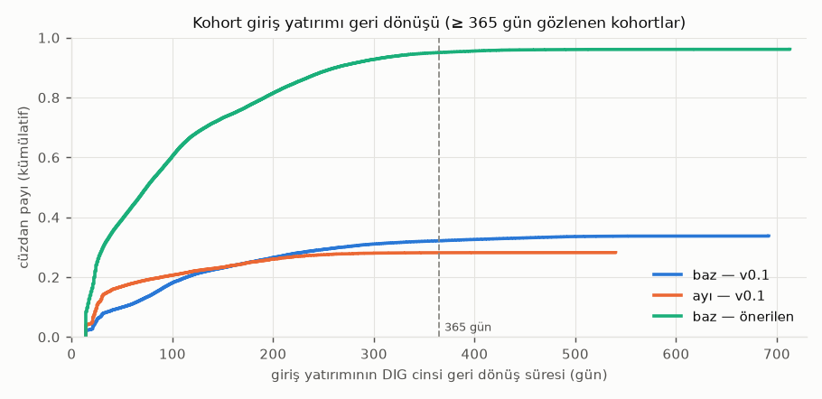

Ölçüm iki tanımla yapıldı:

- **Giriş:** ilk 14 günün capex'i, o günkü DP'nin net üretim payıyla geri ödenir.
- **Nakit:** kümülatif net üretim ≥ kümülatif capex. Yeniden yatırım da capex sayılır, bu yüzden her şeyini yeniden yatıran kohort tanım gereği hiç geri ödemez.

Sonuçlar:

- Bazda haftalık kohortların yalnız **%15'inin** medyan giriş geri dönüşü 365 günün altında (nakit tanımıyla %14). Cüzdanların **%73'ü** 3 yıl içinde giriş yatırımını DIG cinsinden geri alamıyor. Kriter: ≥ %70 kohort; **KALDI**.
- **Neden:**
  - VRGDA çöktükçe ağ ucuz DP ile şişiyor ve DP başına emisyon hızla düşüyor.
  - Erken (pahalı) alınan makinelerin geliri enerjiyle rekabet ediyor.
  - Serbest giriş dengesi, marjinal makinenin getirisini tanım gereği sıfırlıyor.
  - Oyuncuların büyüme düzeltmeli kuralı (`g·τ_s ≥ 1` ise alma) geçmiş 7 günlük büyümeye bakıyor; diğer oyuncuların gelecekteki alımlarını göremiyor.

### 4.6 Yoğunlaşma: Gini, Nakamoto, balina ve sybil

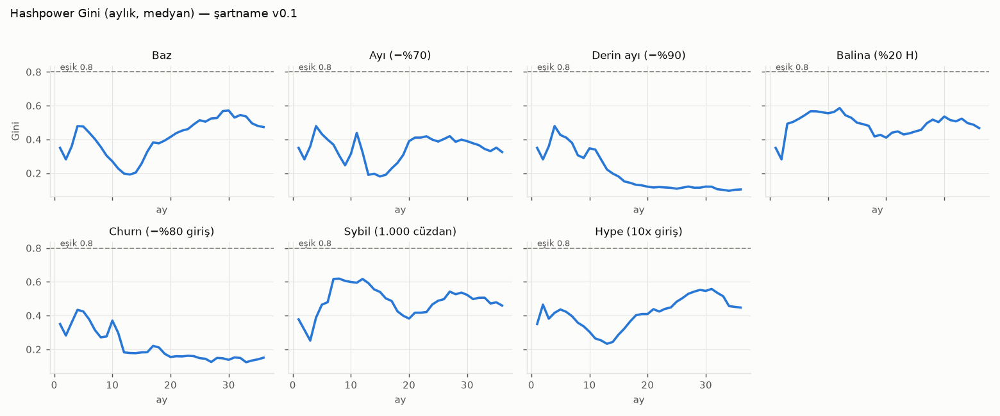

- **Gini:** 12. ayda düşük (baz 0,20; senaryolar 0,18–0,62). Oyun küçüldükçe artıyor: 3–36. aylar arasındaki en yüksek değer bazda 0,80 (eşikte), ayıda 0,87 ve churn'de 0,82.
- **Nakamoto (cüzdan bazlı):** bazda 12. ayda 783, 36. ayda 104. Ayı, derin ayı ve churn'de 36. ayda **2 cüzdan**. Küçük oyuncular gidince H'nin yarısını birkaç balina hesabı tutuyor. §12'deki "Nakamoto < 10" müdahale tetikleyicisi, talep düşüşü senaryolarında 2. yıldan sonra devreye girer.
- **Balina senaryosu:** balina 20 hesapla, $3M bütçe ve 30 gün içinde H'nin yalnız ≈ %15'ine ulaşabildi (P5–P95: %8–21; hedef %20; `results/details.json`, 20 tohum). Kısıtlar:
  - DIG'i AMM'den almak zorunda ve havuz sığ;
  - üs maliyeti dışbükey;
  - VRGDA, satış hızını fiyatla cezalandırıyor.

  Girişi fiyatı 12. ayda ≈ $0,88'e itti. Çıkışında (90. gün) fiyat bir günde sert düştü, ama 24. ayda balinasız bazla aynı seviyedeydi ($0,32).
- **Sybil (genesis'te 1.000 minimum cüzdan, yalnız ücretsiz Hand Auger, kendi kendine referans):**
  - Aynı gün, aynı makine karşılaştırmasında kWh başına emisyon, sıradan Auger'lerin **1,006** katıdır. Fark yalnız referans primidir, ki bu da 0,003 ETH enerji eşiği yüzünden çoğu cüzdanda devreye girmez. **Hesap bölmek kWh başına avantaj sağlamıyor**; §5.2'deki sybil-nötrlük tezi doğrulandı.
  - Şartnamedeki ölçüt ise (ömür boyu emisyon payı / enerji payı) **2,29** çıkıyor. Bu bir bölme avantajı değil, zamanlama etkisi: sybil yalnızca genesis'te (H küçük, kWh başına emisyon en yüksek) ve sonra kârlı olduğu kısa sürelerde kazıyor. Aynı dönemde kazan her genesis madencisi aynı oranı alır.
  - Ücretsiz Auger yine de **sermayesiz** bir giriş sağlıyor. Sybil'in harcadığı enerji USD'si başına aldığı emisyon değeri 1,88; ağ ortalaması 1,34. 1.000 cüzdan, genesis'te emisyonun yaklaşık üçte birini alıyor ve hepsini satıyor: 1. ay fiyatı $0,12, bazda $0,25.

### 4.7 POL derinliği ve ops runway

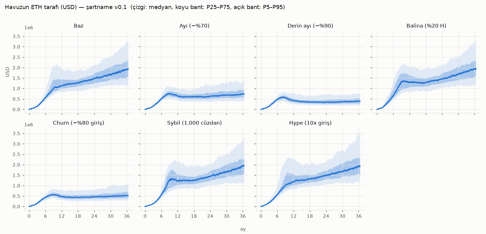

- **POL:** havuzun ETH tarafı bazda 12. ayda ≈ $1,1M (≈ $11 bin ile %2 fiyat hareketi), 36. ayda ≈ $1,9M. Ayıda $0,65M, derin ayıda $0,43M. POL çekilemediği için havuz hiçbir senaryoda boşalmıyor; ama derinlik talep düşüşüyle birlikte DIG fiyatı üzerinden eriyor.
- **Ops:** gelir bazda 12. ayda ≈ $176 bin/ay, 36. ayda ≈ $70 bin/ay. Bu, varsayılan $15 bin/ay maliyetin çok üstünde, dolayısıyla runway her senaryoda sonsuz (kriter **GEÇTİ**). Derin ayıda 36. ayda gelir ≈ $9,7 bin/ay'a (P5 $5,2 bin) iner ve maliyetin altına düşer; ilk iki yılda biriken bakiye bunu fazlasıyla karşılar.
- Ops payının (%30) gelirin büyük kısmını DIG piyasası dışına çıkardığına dikkat edin (§7.2).

### 4.8 Dünya Derinliği (§3.4)

Derinlik = kümülatif tahakkuk eden emisyon / 1.000 m. Rezerve dönüş (yakımın %20'si ve hızlı rafine ücretinin yarısı) tahakkuku hızlandırır.

| | 12. ay | 24. ay | 36. ay |
|---|---|---|---|
| Baz medyanı | ≈ 16.600 m | ≈ 30.700 m | ≈ 42.700 m |

- **Kola Line (12.262 m):** baz medyanında 259. günde geçiliyor; geri dönüşümsüz formül 262. günü veriyor.
- **Moho Line (35.000 m):** 841. günde geçiliyor; formül 861. günü veriyor.
- Senaryolar arası fark küçük (36. ayda 42,6–42,8 bin m), çünkü emisyon rezervin sabit oranıdır ve geri dönüşüm küçüktür. İçerik takvimi talepten neredeyse bağımsız ve öngörülebilir; bu, tasarımın bir hedefiydi.

Kola ve Moho günleri `results/details.json`'dan (20 tohum); önerilen sette 259 ve 835. gün.

## 5. Kabul kriterleri — ayrıntı (şartname v0.1)

| Kriter | Senaryo | Ölçülen | Hedef | Sonuç | Not |
|---|---|---|---|---|---|
| Fiyat 24. ay > %30 × 1. ay ort. | Baz | P = 0,955 | P ≥ 0,5 | GEÇTİ | medyan 24.ay/1.ay = 1,19 |
| Kohort geri dönüşü < 365 gün | Baz | %15 kohort | ≥ %70 | **KALDI** | cüzdanların %73'ü hiç geri almıyor; nakit tanımıyla %14 |
| SR 12. ay | Baz / Ayı / Derin ayı | 0,70 / 0,56 / 0,50 | ≥ 0,6 / ≥ 0,3 / – | GEÇTİ | yalnız yakım: 0,62 / 0,51 / 0,46 |
| Gini < 0,8 | Baz, Derin ayı, Balina, Sybil, Hype | 0,80 / 0,70 / 0,77 / 0,77 / 0,77 | < 0,8 | GEÇTİ | baz eşikte (0,795) |
| Gini < 0,8 | Ayı / Churn | 0,87 / 0,82 | < 0,8 | **KALDI** | 36. ayda Nakamoto = 2 |
| Sybil emisyon payı / enerji payı | Sybil | 2,29 | ≈ 1 | **KALDI** (ölçüt kusurlu) | aynı gün, aynı makine: 1,006 → bölme avantajı yok |
| Ops runway (P5) | Hepsi | ∞ | > 12 ay | GEÇTİ | ops geliri P5: bazda 12. ay $149 bin/ay; derin ayıda 36. ay $5,2 bin/ay |

Gini, her ay aktif madencilerin cüzdan başına aktif DP'si üzerinden ölçüldü; kriter 3–36. aylar arasındaki en yüksek değerin tohumlar arası medyanıdır. Bir balinanın 5 hesabı 5 cüzdan sayılır; varlık bazında yoğunlaşma daha yüksektir. Tam tablolar: `results/tables.md`, `results/criteria.json`.

## 6. Duyarlılık (baz senaryo, değer başına 50 tohum)

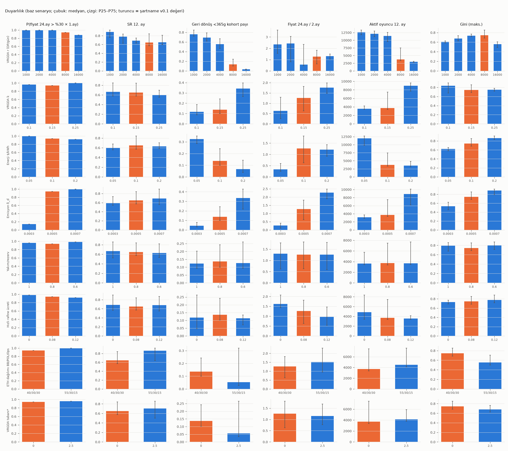

| Ayar | Değer | P(fiyat 24.ay > %30 × 1.ay) | SR 12. ay | Geri dönüş <365g kohort payı | Fiyat 24.ay / 2.ay | Aktif oyuncu 12. ay | Gini (maks.) |
|---|---|---|---|---|---|---|---|
| VRGDA r (DP/gün) | 1000 | 1 | 0.888 [0.764–0.93] | 0.76 [0.718–0.848] | 2.35 [1.56–3.62] | 13K [12K–13K] | 0.606 [0.584–0.628] |
| VRGDA r (DP/gün) | 2000 | 1 | 0.78 [0.628–0.839] | 0.692 [0.619–0.786] | 2.42 [0.811–3.05] | 12K [11K–13K] | 0.674 [0.628–0.736] |
| VRGDA r (DP/gün) | 4000 | 1 | 0.687 [0.633–0.746] | 0.553 [0.467–0.667] | 0.555 [0.458–2.34] | 11K [9543–13K] | 0.736 [0.715–0.769] |
| VRGDA r (DP/gün) | 8000 (v0.1) | 0.94 | 0.647 [0.573–0.841] | 0.136 [0.101–0.242] | 1.26 [0.627–1.82] | 3706 [3361–7463] | 0.743 [0.685–0.853] |
| VRGDA r (DP/gün) | 16000 | 0.88 | 0.649 [0.597–0.812] | 0.0303 [0.0192–0.0392] | 1.3 [1.03–1.5] | 2947 [2719–3124] | 0.556 [0.489–0.605] |
| VRGDA k | 0.1 | 0.96 | 0.662 [0.575–0.845] | 0.117 [0.0874–0.186] | 0.635 [0.257–1.3] | 3539 [3378–4225] | 0.835 [0.678–0.895] |
| VRGDA k | 0.15 (v0.1) | 0.94 | 0.647 [0.573–0.841] | 0.136 [0.101–0.242] | 1.26 [0.627–1.82] | 3706 [3361–7463] | 0.743 [0.685–0.853] |
| VRGDA k | 0.25 | 1 | 0.597 [0.549–0.695] | 0.343 [0.265–0.396] | 1.75 [1.49–1.98] | 8943 [7673–9595] | 0.75 [0.719–0.777] |
| Enerji $/kWh | 0.05 | 1 | 0.593 [0.556–0.676] | 0.324 [0.286–0.35] | 0.335 [0.252–0.593] | 12K [9744–13K] | 0.621 [0.582–0.652] |
| Enerji $/kWh | 0.1 (v0.1) | 0.94 | 0.647 [0.573–0.841] | 0.136 [0.101–0.242] | 1.26 [0.627–1.82] | 3706 [3361–7463] | 0.743 [0.685–0.853] |
| Enerji $/kWh | 0.2 | 0.92 | 0.63 [0.578–0.702] | 0.0667 [0.0381–0.143] | 1.21 [0.918–1.43] | 3521 [3106–4833] | 0.86 [0.829–0.908] |
| Emisyon δ_d | 0.0003 | 0.14 | 0.587 [0.54–0.731] | 0.0426 [0.0312–0.0789] | 0.26 [0.116–0.415] | 3142 [2817–3693] | 0.532 [0.451–0.621] |
| Emisyon δ_d | 0.0005 (v0.1) | 0.94 | 0.647 [0.573–0.841] | 0.136 [0.101–0.242] | 1.26 [0.627–1.82] | 3706 [3361–7463] | 0.743 [0.685–0.853] |
| Emisyon δ_d | 0.0007 | 1 | 0.689 [0.555–0.898] | 0.333 [0.219–0.429] | 2.26 [1.9–2.49] | 8866 [6208–10K] | 0.887 [0.79–0.918] |
| Yakım/rezerv | 1 | 0.96 | 0.665 [0.521–0.856] | 0.122 [0.093–0.202] | 1.29 [0.618–1.78] | 3623 [3411–5755] | 0.791 [0.675–0.857] |
| Yakım/rezerv | 0.8 (v0.1) | 0.94 | 0.647 [0.573–0.841] | 0.136 [0.101–0.242] | 1.26 [0.627–1.82] | 3706 [3361–7463] | 0.743 [0.685–0.853] |
| Yakım/rezerv | 0.6 | 0.98 | 0.627 [0.536–0.819] | 0.126 [0.0928–0.26] | 1.26 [0.593–1.8] | 3693 [3443–7664] | 0.804 [0.711–0.869] |
| Hızlı rafine ücreti | 0 | 0.98 | 0.687 [0.565–0.902] | 0.118 [0.046–0.263] | 1.62 [1.43–2.07] | 4859 [3427–8351] | 0.729 [0.688–0.771] |
| Hızlı rafine ücreti | 0.08 (v0.1) | 0.94 | 0.647 [0.573–0.841] | 0.136 [0.101–0.242] | 1.26 [0.627–1.82] | 3706 [3361–7463] | 0.743 [0.685–0.853] |
| Hızlı rafine ücreti | 0.12 | 0.92 | 0.68 [0.551–0.87] | 0.114 [0.0714–0.135] | 0.969 [0.533–1.47] | 3549 [3343–4119] | 0.777 [0.715–0.882] |
| ETH dağılımı BB/POL/Ops | 40/30/30 (v0.1) | 0.94 | 0.647 [0.573–0.841] | 0.136 [0.101–0.242] | 1.26 [0.627–1.82] | 3706 [3361–7463] | 0.743 [0.685–0.853] |
| ETH dağılımı BB/POL/Ops | 55/30/15 | 1 | 0.861 [0.642–0.921] | 0.0519 [0.0267–0.32] | 1.52 [0.953–2.3] | 4513 [4098–7616] | 0.555 [0.497–0.704] |
| VRGDA tabanı* | 0 (v0.1) | 0.94 | 0.647 [0.573–0.841] | 0.136 [0.101–0.242] | 1.26 [0.627–1.82] | 3706 [3361–7463] | 0.743 [0.685–0.853] |
| VRGDA tabanı* | 2.5 | 0.96 | 0.702 [0.501–0.859] | 0.0549 [0.0341–0.266] | 1.15 [0.762–1.68] | 4130 [3775–5882] | 0.681 [0.625–0.761] |

\* VRGDA taban fiyatı şartnamede yok; bir öneriyi sınamak için eklendi (0 = kapalı).

**Okuma:**

- **`r` en güçlü kaldıraç ve etkisi tek yönlü.** r büyüdükçe:
  - geri dönüşü 365 günün altında olan kohort payı 0,76 → 0,03'e,
  - SR 0,89 → 0,65'e,
  - 12. aydaki aktif oyuncu 13 bin → 2,9 bine iniyor.

  r = 8.000'de VRGDA fiyatı ilk aylarda çöküyor. r ≤ 4.000'de fiyat p0 civarında kalıyor ve makine harcaması 3 yıl boyunca sink olarak çalışıyor.
- **`k`:** 0,25, 0,15'ten iyi (geri dönüş 0,34, oyuncu 8,9 bin, ama SR 0,60). Fiyat hızlı tepki verince lansman koşusunda DP daha erken kısılıyor. 0,10 kötü. r düşükken k'nin etkisi ayrıca sınanmadı.
- **Enerji fiyatı:** $0,05/kWh geri dönüşü ve oyuncu sayısını artırıyor, ama SR (0,59) ve 24.ay/2.ay fiyat oranı (0,34) düşüyor. $0,20 geri dönüşü 0,07'ye indiriyor ve Gini'yi 0,86'ya çıkarıyor. $0,10 makul bir orta nokta.
- **Emisyon `δ_d`:** Düşürmek **kötüleştiriyor**. 0,0003'te P(24. ay > %30 × 1. ay) 0,94 → 0,14'e iniyor; geri dönüş 0,04. Daha az ödül daha az oyuncu demek, ilk ay fiyatı ise görece yükseliyor. 0,0007 geri dönüşü ve oyuncu sayısını artırıyor ama Gini 0,89 oluyor. δ_d kodda sabittir (§12); 0,0005 için bir gerekçe bulunamadı, ama değiştirmek için de güçlü bir kanıt yok.
- **Yakım/rezerv oranı (100/0, 80/20, 60/40):** Etkisi küçük (SR 0,67 / 0,65 / 0,63). %20'lik geri dönüş emisyonu yıllara yaymaktan başka bir şey yapmıyor. 80/20 korunabilir.
- **Hızlı rafine ücreti (%0 / 8 / 12):** Etkisi küçük (SR 0,69 / 0,65 / 0,68). %12, 24.ay/2.ay oranını 1,26 → 0,97'ye düşürüyor. %8 korunabilir.
- **ETH dağılımı 55/30/15 (tek başına):**
  - SR 0,65 → 0,86, Gini (en yüksek) 0,74 → 0,56, 24.ay/2.ay fiyat oranı 1,26 → 1,52.
  - Geri dönüşü **düzeltmiyor** (0,14 → 0,05): VRGDA hâlâ çöküyor.
- **VRGDA tabanı 2,5 DIG/DP (r = 8.000 ile):** SR 0,65 → 0,70, Gini 0,74 → 0,68, ama geri dönüş 0,14 → 0,05. Taban, sorunu kökünden çözmüyor.

## 7. Önerilen parametre değişiklikleri

> Bu bölüm yalnızca **öneridir**; şartname değiştirilmedi. Önerilen set `sim/param_sets/v01_recommended.json`'dadır ve tüm senaryolarda 100'er tohumla koşuldu. Sonuçların tamamı `results/scenarios_recommended.json` ve `results/tables.md`'de.

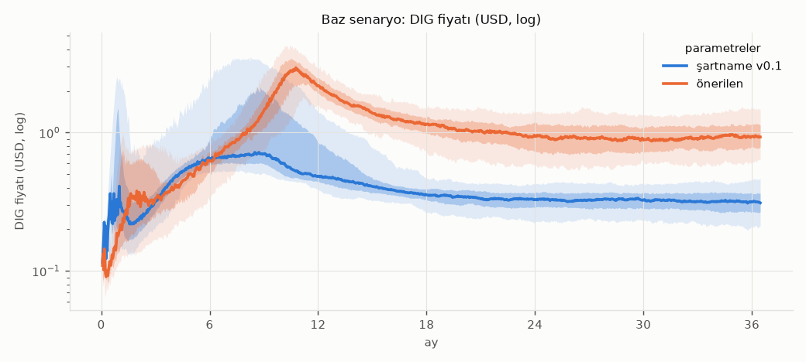 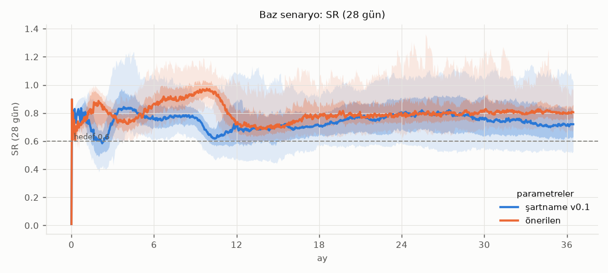
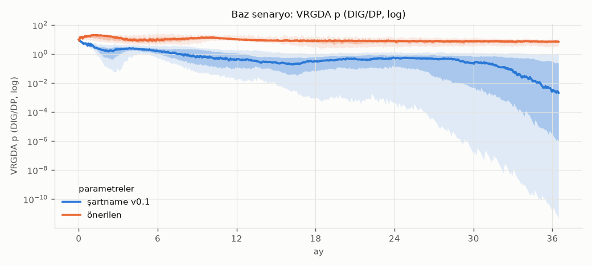 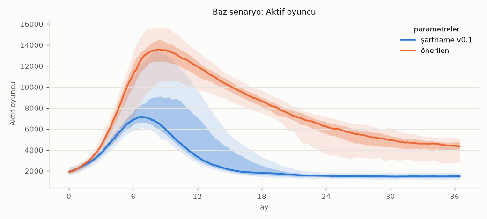
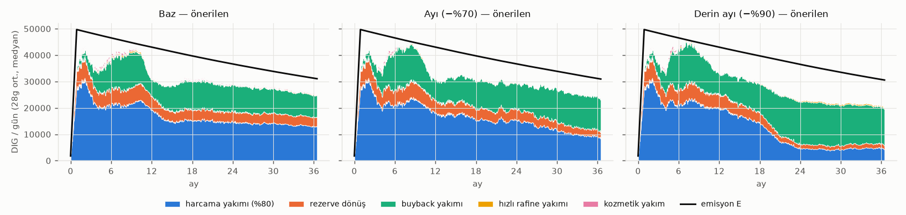

### Ö1 — VRGDA `r`: 8.000 → **2.000 DP/gün**

Şartname sınırı 1.000–100.000; değişiklik ayarlanabilir parametre kapsamında.

**Gerekçe.** `r`, satış hedefini ağın enerjiyle taşıyabileceği DP birikimiyle uyumlu hale getirmeli.

- Serbest giriş dengesinde (§5.2) aktif DP birkaç yüz bin mertebesindedir. Yeni DP talebinin çoğu ayrılan oyuncuların yerini dolduran yenileme talebidir (günde birkaç yüz–birkaç bin DP).
- r = 8.000'de satış hedefin gerisinde kalır; fiyat üstel düşer ve makineler bedavalaşır.
- Bunun üç sonucu var: (a) harcama yakımı kaybolur; (b) DP fazlası getiriyi enerji maliyetine eşitler, yani yeni oyuncu için kârlı yatırım kalmaz; (c) oyuncular ayrılır.

**Ölçülen etki.**

| Metrik (baz) | v0.1 | Yalnız r = 2.000 (50 tohum) | Önerilen set (100 tohum) |
|---|---|---|---|
| Kohort geri dönüşü < 365 gün (pay) | 0,15 | 0,69 | **0,97** (medyan 79 gün) |
| SR 12. ay | 0,70 | 0,78 | 0,72 |
| VRGDA p, 12. ay (DIG/DP) | 0,49 | ≈ 12 | 12,5 |
| Aktif oyuncu 12. / 36. ay | 3,7 bin / 1,5 bin | 12 bin / – | 12,3 bin / 4,4 bin |
| Fiyat 24. ay | $0,34 | – | $0,95 |
| Gini en yüksek (3–36. ay) | 0,80 | 0,67 | 0,63 |
| Ayıda SR / geri dönüş | 0,56 / 0,07 | – | 0,72 / 0,91 |
| Derin ayıda SR / geri dönüş | 0,50 / 0,25 | – | 0,78 / 0,64 |

Önerilen set bütün senaryolarda daha iyi: churn'de geri dönüş 0,09 → 0,67, 36. ayda Nakamoto 2 → 11. r = 1.000 (şartname alt sınırı) bazda SR ve Gini açısından daha da iyi (0,89 / 0,61). Ama yönetişimin aşağı ayar payı kalmaz; bu yüzden 2.000 önerilir.

**Bedeli.**

- **Kıt DP, büyük bütçelilerde toplanıyor:** 12. ay Gini'si 0,20 → 0,56 (sonraki aylarda yine de daha düşük).
- **Yeni oyuncunun USD cinsinden giriş maliyeti artıyor:** DIG fiyatı 12. ayda $2,45, v0.1'de $0,48.
- **İlk ayın fiyatı düşük kalıyor** ($0,125 vs $0,245): genesis DIG'i daha az makine alıyor. Bu da 24.ay/1.ay oranını büyütüyor (6,9). Bu oranı "başarı" olarak okumamak gerekir (bkz. Ö4).

### Ö2 — ETH gelir dağılımı: buyback/POL/ops = 40/30/30 → **55/30/15**

Şartname sınırları: buyback %30–60, ops %10–35; değişiklik bu aralıkta.

**Gerekçe.** Ops payı gelirin DIG piyasasından kalıcı olarak çıkan kısmıdır.

- Bazda ilk yıl ops geliri ≈ $2,3M; varsayılan maliyet ≈ $0,18M/yıl.
- Önerilen sette 12. ay ops geliri hâlâ $121 bin/ay (P5 $110 bin).
- Buyback, dış gelirin tokene dönen tek kanalıdır.

**Ölçülen etki.**

- **Tek başına (r = 8.000):** SR 0,65 → 0,86, Gini en yüksek 0,74 → 0,56, 24.ay/2.ay fiyat oranı 1,26 → 1,52. Geri dönüşü düzeltmiyor.
- **Ö1 ile birlikte:** fiyat 24. ayda $0,95, geri dönüş 0,97, Gini en yüksek 0,63.
- **Ops riski:** derin ayıda 36. ay ops geliri P5 = $6,5 bin/ay. Bu, varsayılan $15 bin maliyetin altındadır ama ilk iki yılın birikimi bunu karşılar.

**Not:** Ops payının nihai değeri gerçek bütçeye göre seçilmeli. Yaklaşık kural: kötü senaryoda ops geliri bütçenin ≈ 2 katını karşılamalı.

### Ö3 — §12 müdahale politikası: "SR < 0,5 → r artırımı" ifadesi **ters yönde**

Duyarlılık tablosunda r büyüdükçe SR ve geri dönüş düşüyor. Önerilen kural: **"4 hafta üst üste SR < 0,5 veya p(t,n)/p0 < 0,25 → r'yi %25 azalt."** p(t,n)/p0 zaten idx olarak hesaplanıyor, yani bu gözlenebilir bir öncü göstergedir. Ölçülen etki: §6'daki r taraması.

### Ö4 — §13 kabul kriterlerinin tanımları netleştirilmeli

Bu bir parametre değişikliği değil; ölçüt tanımlarıdır.

1. **Fiyat kriterinin referansı:** "1. ay ortalaması" lansman dinamiğine çok duyarlı. Örnekler: δ_d = 0,0003 kriteri 0,94 → 0,14'e düşürüyor; önerilen sette ilk ay düşük olduğu için oran şişiyor. Öneri: **2. ay ortalaması** ya da 30. günden itibaren 30 günlük TWAP. Tablolarda "24.ay/2.ay" ayrıca verildi.
2. **Kohort geri dönüşü:** Tanımı yazılmalı. Bu raporda "ilk 14 günün capex'i, o DP'nin net üretim payıyla geri ödenir" kullanıldı. Nakit tanımında yeniden yatırım da capex sayıldığı için optimizer tipi bir kohort tanım gereği asla geri ödemez.
3. **Sybil ölçütü:** "Aynı gün, aynı makine tipiyle kWh başına emisyon oranı ≤ 1 + referans oranı" olarak tanımlanmalı. Ömür boyu pay oranı genesis zamanlamasıyla karışıyor: v0.1'de 2,29, önerilen sette 0,91.
4. **Gini/Nakamoto:** Cüzdan mı, varlık mı (balina = 5 hesap), aktif DP mi, kurulu DP mi, aylık en yüksek değer mi — belirtilmeli. Simülasyon cüzdan + aktif DP + aylık en yüksek değeri kullandı.

### Ö5 — Genesis için açıklık gerektiren noktalar (parametre önerisi değil)

- **P0'ın "genesis enerji harcaması":** satın alınan kWh mı (tank ön doldurması dahil; simülasyonun varsayımı), tüketilen kWh mi? Tüketim tabanı P0'ı ≈ 3–4 kat düşürür; DIG_LP değişmez. Formül değiştirilemez sayıldığından deploy öncesi yazılmalı.
- **Genesis'teki %40 buyback payının akıbeti tanımlı değil.** Simülasyonda birikip açılıştan sonra günlük tavanla harcanıyor.
- **DIG_LP sabit olarak genesis tahakkukunun %30'u** (≈ 40 bin DIG); havuz ince başlıyor. Ön keşifte (16 tohum, rapor koşularında değil) genesis gelirinin tamamını POL'a yönlendirmek ilk ay fiyatını düşürmedi, artırdı: daha derin havuz daha büyük alımları kaldırıyor. Bu yüzden öneri yok; opsiyonel anti-snipe hook'u (§11) ayrı değerlendirilmeli.

### Önerilmeyenler (ölçüldü, değişiklik gerekmiyor)

- δ_d azaltma (kötüleştiriyor)
- yakım oranı 100/0 veya 60/40 (etkisi küçük)
- hızlı ücret %0/%12 (etkisi küçük)
- enerji fiyatı $0,05/$0,20 (değiş-tokuş)
- VRGDA tabanı (r = 2.000 ile etkisi yok; r = 8.000 ile geri dönüşü bozuyor)

## 8. Talep kalibrasyonu sağlamlığı (baz, 25 tohum)

Tüm talep girdileri birlikte 0,5 ve 2 ile çarpıldı: genesis oyuncusu, dalga, kuyruk, spekülatör büyüklüğü, balina sıklığı.

| Talep çarpanı | Parametreler | P(24.ay > %30 × 1.ay) | SR 12. ay | Geri dönüş <365g kohort payı | Fiyat 24.ay / 2.ay | Aktif oyuncu 12. ay |
|---|---|---|---|---|---|---|
| x0.5 | önerilen | 1 | 0.648 | 0.919 | 6.35 | 5430 |
| x2 | önerilen | 1 | 0.981 | 0.981 | 1.47 | 25K |
| x0.5 | şartname v0.1 | 1 | 0.708 | 0.00962 | 1.85 | 1668 |
| x2 | şartname v0.1 | 1 | 0.708 | 0.819 | 0.354 | 24K |

- **Önerilen set her iki uçta kriteri geçiyor:** 0,5 talepte %92 kohort, 2 talepte %98.
- **Şartname v0.1:** düşük talepte geri dönüş %1'e çöküyor, yüksek talepte %82 ile geçiyor. Yüksek talepte satışlar r = 8.000'e yetişiyor, yani **r'nin doğru değeri talebe bağlı.** Bu, Ö1'in "başlangıç değeri" olarak düşük r ve Ö3'ün ters yönlü müdahale kuralı ile birlikte okunmalı.
- **Mutlak fiyatlar talep çarpanıyla birlikte değişiyor:** bu sayılar tahmin değildir.

## 9. Ham sonuç tabloları

### 9.1 Şartname v0.1 (200 tohum, medyan [P5–P95])

| Metrik | Baz | Ayı (talep −%70, 4. ay) | Derin ayı (talep −%90, 4. ay) | Balina (H'nin %20'si, 2. ay, 30 gün sonra çıkış) | Churn (3. aydan sonra yeni giriş −%80) | Sybil (1.000 minimum cüzdan, genesis) | Hype (1. ayda 2 hafta 10x giriş) |
|---|---|---|---|---|---|---|---|
| P0 (USD, market açılışı) | 0.116 [0.0983–0.134] | 0.116 [0.0983–0.134] | 0.116 [0.0983–0.134] | 0.116 [0.0983–0.134] | 0.116 [0.0983–0.134] | 0.151 [0.136–0.171] | 0.116 [0.0983–0.134] |
| Açılış POL (ETH) | 1.57 [1.33–1.81] | 1.57 [1.33–1.81] | 1.57 [1.33–1.81] | 1.57 [1.33–1.81] | 1.57 [1.33–1.81] | 2.04 [1.84–2.3] | 1.57 [1.33–1.81] |
| Açılış DIG_LP | 40K [39K–42K] | 40K [39K–42K] | 40K [39K–42K] | 40K [39K–42K] | 40K [39K–42K] | 40K [39K–42K] | 40K [39K–42K] |
| Fiyat 1. ay ort. (USD) | 0.245 [0.14–0.975] | 0.245 [0.14–0.975] | 0.245 [0.14–0.975] | 0.245 [0.14–0.975] | 0.245 [0.14–0.975] | 0.12 [0.103–0.135] | 0.245 [0.14–0.975] |
| Fiyat 1. ay tepe | 0.373 [0.191–2.69] | 0.373 [0.191–2.69] | 0.373 [0.191–2.69] | 0.373 [0.191–2.69] | 0.373 [0.191–2.69] | 0.182 [0.149–0.222] | 0.373 [0.191–2.69] |
| Fiyat 12. ay | 0.484 [0.417–1.71] | 0.285 [0.191–0.542] | 0.152 [0.0902–0.273] | 0.881 [0.414–1.8] | 0.186 [0.132–0.295] | 0.894 [0.414–1.77] | 0.488 [0.389–1.88] |
| Fiyat 24. ay | 0.335 [0.232–0.417] | 0.102 [0.0679–0.159] | 0.0446 [0.0302–0.0865] | 0.317 [0.222–0.412] | 0.0709 [0.0465–0.106] | 0.324 [0.23–0.414] | 0.336 [0.239–0.428] |
| Fiyat 36. ay | 0.314 [0.207–0.435] | 0.0893 [0.0564–0.135] | 0.039 [0.0234–0.0632] | 0.313 [0.213–0.448] | 0.062 [0.0392–0.108] | 0.312 [0.207–0.448] | 0.309 [0.209–0.462] |
| Fiyat 24.ay / 1.ay | 1.19 [0.313–2.4] | 0.365 [0.103–0.841] | 0.166 [0.0428–0.395] | 1.2 [0.3–2.42] | 0.262 [0.0665–0.592] | 2.69 [1.86–3.49] | 1.26 [0.29–2.39] |
| Fiyat 24.ay / 2.ay | 1.2 [0.261–2.21] | 0.397 [0.0626–0.809] | 0.174 [0.0381–0.367] | 1.22 [0.246–2.21] | 0.268 [0.0505–0.54] | 1.93 [1.33–2.65] | 1.03 [0.196–1.98] |
| Aktif oyuncu 12. ay | 3733 [3054–10K] | 1545 [1329–2162] | 794 [603–1116] | 5583 [3097–12K] | 1012 [833–1287] | 6111 [3213–10K] | 3936 [3315–12K] |
| Aktif oyuncu 36. ay | 1489 [1188–1818] | 323 [259–393] | 92.7 [70.8–133] | 1486 [1211–1900] | 201 [158–268] | 1478 [1207–1865] | 1493 [1219–1861] |
| Aktif H 12. ay (DP) | 460K [400K–913K] | 254K [180K–407K] | 142K [87K–249K] | 630K [388K–963K] | 178K [128K–268K] | 605K [400K–964K] | 462K [367K–965K] |
| Aktif H 36. ay (DP) | 209K [149K–286K] | 79K [54K–113K] | 31K [17K–59K] | 210K [152K–279K] | 56K [32K–95K] | 208K [155K–292K] | 208K [150K–304K] |
| VRGDA p 12. ay (DIG/DP) | 0.49 [0.0311–1.88] | 0.0151 [0.000107–0.454] | 1e-05 [2.17e-07–0.000503] | 0.823 [0.0364–2.24] | 0.000485 [4.76e-06–0.00902] | 0.97 [0.0307–2.05] | 0.491 [0.0193–2.44] |
| SR 12. ay (yakım+rezerv) | 0.704 [0.476–1.08] | 0.555 [0.464–0.707] | 0.5 [0.436–0.701] | 0.646 [0.467–1.08] | 0.537 [0.455–0.677] | 0.643 [0.443–1.04] | 0.694 [0.466–1.02] |
| SR 12. ay (yalnız yakım) | 0.62 [0.437–0.927] | 0.505 [0.417–0.633] | 0.462 [0.41–0.621] | 0.58 [0.424–0.911] | 0.493 [0.421–0.604] | 0.573 [0.404–0.892] | 0.613 [0.418–0.888] |
| SR 36. ay | 0.707 [0.51–1.1] | 0.728 [0.406–1.26] | 0.703 [0.398–1.29] | 0.717 [0.532–1.1] | 0.735 [0.412–1.28] | 0.715 [0.511–1.11] | 0.698 [0.524–1.03] |
| NE 12. ay (28g toplam, DIG) | 451K [86K–677K] | 591K [431K–685K] | 643K [440K–705K] | 503K [103K–691K] | 606K [467K–691K] | 509K [122K–715K] | 457K [120K–689K] |
| NE 3 yıl kümülatif (DIG) | 14.72M [13.26M–16.12M] | 15.92M [14.07M–17.83M] | 17.21M [15.27M–19.39M] | 14.83M [13.30M–16.58M] | 16.02M [14.26M–17.99M] | 14.73M [13.31M–16.29M] | 14.68M [13.24M–16.20M] |
| RCR 12. ay | 0.364 [0.219–0.387] | 0.34 [0.252–0.381] | 0.351 [0.322–0.369] | 0.289 [0.21–0.382] | 0.362 [0.322–0.38] | 0.284 [0.203–0.383] | 0.364 [0.189–0.388] |
| s (satış/emisyon) 12. ay | 0.797 [0.534–0.925] | 0.865 [0.636–0.93] | 0.889 [0.818–0.919] | 0.714 [0.501–0.899] | 0.91 [0.818–0.931] | 0.691 [0.496–0.894] | 0.798 [0.457–0.918] |
| P* 12. ay (USD) | 0.182 [0.153–0.382] | 0.0932 [0.0679–0.153] | 0.0518 [0.0305–0.0948] | 0.245 [0.15–0.405] | 0.0654 [0.0474–0.0997] | 0.236 [0.149–0.395] | 0.182 [0.142–0.41] |
| Giriş geri dönüşü <365g kohort payı | 0.151 [0.0326–0.448] | 0.0667 [0.019–0.242] | 0.247 [0.12–0.394] | 0.2 [0.0495–0.486] | 0.0857 [0.0286–0.219] | 0.19 [0.0577–0.423] | 0.137 [0.05–0.543] |
| Giriş geri dönüşü medyan (gün) | ∞ [120–∞] | ∞ [∞–∞] | ∞ [101–∞] | ∞ [77–∞] | ∞ [∞–∞] | ∞ [274–∞] | ∞ [80–∞] |
| Nakit geri dönüşü <365g kohort payı | 0.143 [0.0286–0.248] | 0.0857 [0.0286–0.229] | 0.248 [0.114–0.422] | 0.162 [0.0286–0.343] | 0.133 [0.0381–0.286] | 0.152 [0.0286–0.248] | 0.133 [0.0286–0.267] |
| Gini 12. ay | 0.197 [0.0953–0.686] | 0.321 [0.0879–0.639] | 0.28 [0.117–0.588] | 0.585 [0.101–0.681] | 0.181 [0.0955–0.571] | 0.615 [0.143–0.709] | 0.252 [0.138–0.67] |
| Gini maks. (3–36. ay) | 0.795 [0.555–0.93] | 0.872 [0.744–0.947] | 0.697 [0.494–0.863] | 0.767 [0.568–0.92] | 0.818 [0.503–0.932] | 0.769 [0.559–0.93] | 0.77 [0.569–0.927] |
| Nakamoto 12. ay (cüzdan) | 783 [431–1049] | 223 [164–442] | 116 [64.1–224] | 758 [402–1236] | 160 [102–227] | 678 [360–982] | 833 [450–1377] |
| POL ETH tarafı 12. ay (USD) | 1.12M [801K–1.96M] | 648K [414K–1.03M] | 426K [250K–750K] | 1.30M [826K–2.07M] | 476K [323K–787K] | 1.22M [807K–2.07M] | 1.18M [834K–2.24M] |
| %2 derinlik 12. ay (USD) | 11K [7975–20K] | 6453 [4124–10K] | 4240 [2485–7466] | 13K [8220–21K] | 4734 [3215–7830] | 12K [8030–21K] | 12K [8296–22K] |
| Ops geliri 12. ay (USD/ay) | 176K [149K–372K] | 90K [67K–147K] | 50K [30K–91K] | 238K [144K–396K] | 64K [46K–96K] | 227K [145K–385K] | 176K [138K–397K] |
| Ops geliri 36. ay (USD/ay) | 70K [51K–103K] | 21K [14K–32K] | 9666 [5208–15K] | 70K [53K–102K] | 15K [9451–26K] | 70K [51K–102K] | 70K [52K–107K] |
| Ops runway 12. ay (ay) | ∞ [∞–∞] | ∞ [∞–∞] | ∞ [∞–∞] | ∞ [∞–∞] | ∞ [∞–∞] | ∞ [∞–∞] | ∞ [∞–∞] |
| Kalıcı yakılan 36. ay (DIG) | 28.17M [26.63M–29.62M] | 26.86M [24.69M–28.79M] | 25.52M [23.22M–27.45M] | 28.09M [26.33M–29.55M] | 26.71M [24.71M–28.60M] | 28.28M [26.54M–29.55M] | 28.15M [26.60M–29.57M] |
| Basılan 36. ay (DIG) | 42.73M [42.58M–42.93M] | 42.65M [42.51M–42.82M] | 42.56M [42.42M–42.71M] | 42.81M [42.58M–42.97M] | 42.61M [42.50M–42.75M] | 42.76M [42.62M–42.92M] | 42.70M [42.56M–42.97M] |
| Dolaşım 36. ay (DIG) | 8.68M [6.75M–10.68M] | 10.26M [7.97M–12.76M] | 11.86M [9.54M–14.76M] | 8.57M [6.77M–10.85M] | 10.54M [8.08M–12.86M] | 8.42M [6.94M–10.56M] | 8.72M [6.89M–10.73M] |
| P(fiyat 24.ay > %30 × 1.ay ort.) | 0.955 | 0.56 | 0.15 | 0.955 | 0.39 | 1 | 0.94 |

### 9.2 Önerilen parametreler (100 tohum)

| Metrik | Baz | Ayı (talep −%70, 4. ay) | Derin ayı (talep −%90, 4. ay) | Balina (H'nin %20'si, 2. ay, 30 gün sonra çıkış) | Churn (3. aydan sonra yeni giriş −%80) | Sybil (1.000 minimum cüzdan, genesis) | Hype (1. ayda 2 hafta 10x giriş) |
|---|---|---|---|---|---|---|---|
| P0 (USD, market açılışı) | 0.11 [0.086–0.128] | 0.11 [0.086–0.128] | 0.11 [0.086–0.128] | 0.11 [0.086–0.128] | 0.11 [0.086–0.128] | 0.148 [0.133–0.167] | 0.11 [0.086–0.128] |
| Açılış POL (ETH) | 1.48 [1.16–1.73] | 1.48 [1.16–1.73] | 1.48 [1.16–1.73] | 1.48 [1.16–1.73] | 1.48 [1.16–1.73] | 2 [1.79–2.26] | 1.48 [1.16–1.73] |
| Açılış DIG_LP | 41K [39K–42K] | 41K [39K–42K] | 41K [39K–42K] | 41K [39K–42K] | 41K [39K–42K] | 40K [39K–42K] | 41K [39K–42K] |
| Fiyat 1. ay ort. (USD) | 0.125 [0.0966–0.251] | 0.125 [0.0966–0.251] | 0.125 [0.0966–0.251] | 0.125 [0.0966–0.251] | 0.125 [0.0966–0.251] | 0.0823 [0.074–0.0922] | 0.125 [0.0966–0.251] |
| Fiyat 1. ay tepe | 0.194 [0.141–0.674] | 0.194 [0.141–0.674] | 0.194 [0.141–0.674] | 0.194 [0.141–0.674] | 0.194 [0.141–0.674] | 0.122 [0.106–0.141] | 0.194 [0.141–0.674] |
| Fiyat 12. ay | 2.45 [1.58–3.3] | 1.35 [1.01–1.96] | 0.926 [0.582–1.43] | 2.48 [1.63–3.62] | 0.908 [0.586–1.3] | 2.24 [1.39–2.9] | 2.34 [1.63–3.45] |
| Fiyat 24. ay | 0.95 [0.578–1.35] | 0.393 [0.247–0.622] | 0.182 [0.0923–0.315] | 1.02 [0.629–1.46] | 0.257 [0.165–0.426] | 0.897 [0.56–1.32] | 1.01 [0.701–1.47] |
| Fiyat 36. ay | 0.929 [0.589–1.5] | 0.286 [0.2–0.465] | 0.102 [0.0602–0.178] | 1.02 [0.621–1.5] | 0.189 [0.109–0.32] | 0.83 [0.554–1.25] | 1.03 [0.606–1.59] |
| Fiyat 24.ay / 1.ay | 6.93 [2.96–11.5] | 2.78 [1.48–4.99] | 1.21 [0.485–2.73] | 7.58 [3.24–11.7] | 1.84 [1.07–3.32] | 10.4 [6.65–16.5] | 7.26 [3.69–12.9] |
| Fiyat 24.ay / 2.ay | 3.01 [1.02–7.49] | 1.12 [0.457–3.09] | 0.528 [0.155–1.5] | 2.89 [1.18–8.36] | 0.778 [0.356–2.06] | 6.05 [3.77–9.54] | 4.21 [2.11–6.96] |
| Aktif oyuncu 12. ay | 12K [9969–14K] | 4379 [3608–5768] | 2509 [1915–3519] | 13K [11K–14K] | 3255 [2405–3807] | 11K [8020–12K] | 13K [9995–15K] |
| Aktif oyuncu 36. ay | 4430 [2694–5188] | 594 [443–716] | 126 [80.7–205] | 4548 [3211–5142] | 284 [215–421] | 4173 [2705–4924] | 4495 [2975–5340] |
| Aktif H 12. ay (DP) | 532K [482K–560K] | 385K [313K–454K] | 286K [147K–408K] | 521K [491K–546K] | 301K [178K–395K] | 556K [499K–591K] | 550K [503K–584K] |
| Aktif H 36. ay (DP) | 290K [219K–358K] | 168K [125K–245K] | 77K [36K–128K] | 296K [219K–367K] | 123K [85K–205K] | 289K [217K–373K] | 296K [216K–392K] |
| VRGDA p 12. ay (DIG/DP) | 12.5 [10.1–15.7] | 11.1 [8.04–15] | 10.8 [7.6–14.7] | 12.8 [10.1–16.9] | 10.3 [7.08–13.8] | 11.6 [8.3–13.9] | 13.1 [9.64–16] |
| SR 12. ay (yakım+rezerv) | 0.72 [0.608–0.986] | 0.723 [0.569–0.929] | 0.775 [0.564–1.01] | 0.787 [0.615–1.06] | 0.821 [0.601–1.1] | 0.718 [0.565–0.913] | 0.76 [0.615–1.05] |
| SR 12. ay (yalnız yakım) | 0.602 [0.513–0.84] | 0.608 [0.475–0.801] | 0.656 [0.488–0.855] | 0.659 [0.512–0.906] | 0.695 [0.517–0.917] | 0.602 [0.485–0.777] | 0.632 [0.516–0.861] |
| SR 36. ay | 0.795 [0.657–0.987] | 0.774 [0.622–0.961] | 0.679 [0.541–0.958] | 0.797 [0.714–0.997] | 0.745 [0.583–0.958] | 0.782 [0.671–1.03] | 0.797 [0.7–1] |
| NE 12. ay (28g toplam, DIG) | 479K [185K–582K] | 472K [230K–631K] | 415K [173K–616K] | 407K [94K–585K] | 361K [97K–577K] | 477K [237K–613K] | 433K [152K–580K] |
| NE 3 yıl kümülatif (DIG) | 12.75M [12.04M–14.48M] | 12.98M [12.09M–13.61M] | 14.59M [13.32M–15.41M] | 12.68M [12.06M–13.51M] | 13.16M [12.36M–14.34M] | 13.05M [12.08M–14.87M] | 12.55M [11.98M–14.00M] |
| RCR 12. ay | 0.149 [0.112–0.271] | 0.182 [0.113–0.301] | 0.19 [0.0974–0.315] | 0.165 [0.104–0.279] | 0.215 [0.13–0.424] | 0.151 [0.121–0.282] | 0.159 [0.108–0.224] |
| s (satış/emisyon) 12. ay | 0.361 [0.322–0.446] | 0.34 [0.262–0.419] | 0.338 [0.215–0.467] | 0.367 [0.314–0.446] | 0.387 [0.287–0.514] | 0.368 [0.332–0.47] | 0.377 [0.314–0.477] |
| P* 12. ay (USD) | 0.343 [0.314–0.36] | 0.229 [0.182–0.275] | 0.157 [0.0877–0.237] | 0.346 [0.32–0.362] | 0.184 [0.111–0.236] | 0.344 [0.304–0.373] | 0.356 [0.323–0.382] |
| Giriş geri dönüşü <365g kohort payı | 0.971 [0.628–1] | 0.913 [0.581–1] | 0.643 [0.505–0.732] | 1 [0.798–1] | 0.667 [0.495–0.838] | 0.91 [0.546–0.971] | 0.99 [0.699–1] |
| Giriş geri dönüşü medyan (gün) | 79 [38–160] | 85 [44–145] | 75 [35–163] | 37 [26–68] | 70 [44–145] | 96 [69–206] | 59 [23–178] |
| Nakit geri dönüşü <365g kohort payı | 0.762 [0.343–1] | 0.495 [0.286–0.705] | 0.371 [0.124–0.552] | 0.914 [0.467–1] | 0.362 [0.0857–0.552] | 0.648 [0.305–0.886] | 0.81 [0.305–1] |
| Gini 12. ay | 0.555 [0.506–0.648] | 0.573 [0.482–0.629] | 0.542 [0.449–0.634] | 0.534 [0.502–0.567] | 0.538 [0.466–0.636] | 0.623 [0.568–0.67] | 0.548 [0.503–0.642] |
| Gini maks. (3–36. ay) | 0.634 [0.538–0.776] | 0.742 [0.695–0.814] | 0.706 [0.616–0.861] | 0.572 [0.53–0.71] | 0.8 [0.685–0.892] | 0.756 [0.678–0.81] | 0.592 [0.523–0.757] |
| Nakamoto 12. ay (cüzdan) | 1517 [742–2039] | 609 [378–1004] | 394 [196–647] | 1816 [1461–2168] | 470 [242–692] | 958 [589–1381] | 1754 [891–2221] |
| POL ETH tarafı 12. ay (USD) | 1.52M [1.13M–2.05M] | 1.01M [766K–1.50M] | 809K [518K–1.15M] | 1.43M [1.03M–1.84M] | 777K [562K–1.23M] | 1.56M [1.08M–2.03M] | 1.60M [1.18M–2.17M] |
| %2 derinlik 12. ay (USD) | 15K [11K–20K] | 10K [7626–15K] | 8045 [5156–11K] | 14K [10K–18K] | 7734 [5593–12K] | 16K [11K–20K] | 16K [12K–22K] |
| Ops geliri 12. ay (USD/ay) | 121K [110K–126K] | 81K [65K–96K] | 56K [31K–83K] | 122K [112K–128K] | 65K [39K–83K] | 121K [107K–131K] | 125K [114K–134K] |
| Ops geliri 36. ay (USD/ay) | 63K [43K–79K] | 29K [20K–44K] | 12K [6470–20K] | 66K [44K–83K] | 19K [13K–35K] | 61K [42K–81K] | 66K [46K–86K] |
| Ops runway 12. ay (ay) | ∞ [∞–∞] | ∞ [∞–∞] | ∞ [∞–∞] | ∞ [∞–∞] | ∞ [∞–∞] | ∞ [∞–∞] | ∞ [∞–∞] |
| Kalıcı yakılan 36. ay (DIG) | 30.46M [28.49M–31.14M] | 30.18M [29.50M–31.03M] | 28.44M [27.62M–29.63M] | 30.53M [29.70M–31.19M] | 29.95M [28.81M–30.77M] | 30.00M [28.12M–30.93M] | 30.57M [28.98M–31.22M] |
| Basılan 36. ay (DIG) | 43.02M [42.88M–43.12M] | 43.01M [42.89M–43.12M] | 42.87M [42.79M–42.98M] | 43.11M [43.01M–43.15M] | 42.96M [42.84M–43.06M] | 42.92M [42.83M–42.97M] | 43.02M [42.91M–43.10M] |
| Dolaşım 36. ay (DIG) | 5.64M [4.75M–7.91M] | 6.09M [4.97M–7.04M] | 8.56M [7.16M–9.74M] | 5.35M [4.59M–6.24M] | 6.57M [5.46M–8.01M] | 6.26M [5.12M–8.38M] | 5.48M [4.66M–6.89M] |
| P(fiyat 24.ay > %30 × 1.ay ort.) | 1 | 1 | 0.99 | 1 | 1 | 1 | 1 |

## 10. Yeniden üretim ve dosyalar

- `sim/README.md`: kurulum, testler (`python -m unittest discover -s tests -t .`), vektörler (`make_vectors.py`), senaryolar (`run_scenarios.py`).
- `sim/params.json` + `sim/PARAMS.md`: tüm parametreler ve anlamları.
- `sim/param_sets/v01_recommended.json`: önerilen set (v0.1 çalışmasının).
- `sim/results/`: JSON sonuçlar, `tables.md`, `fans.npz` (günlük yüzdelik yolları), `details.json` (balina payı, satış akışları, derinlik).
- `sim/vectors/`: Solidity diferansiyel testleri için altın vektörler: saatlik emisyon (2.000 saat), VRGDA (63 nokta), üs tablosu (L1–L30), market açılışı (6 durum).
